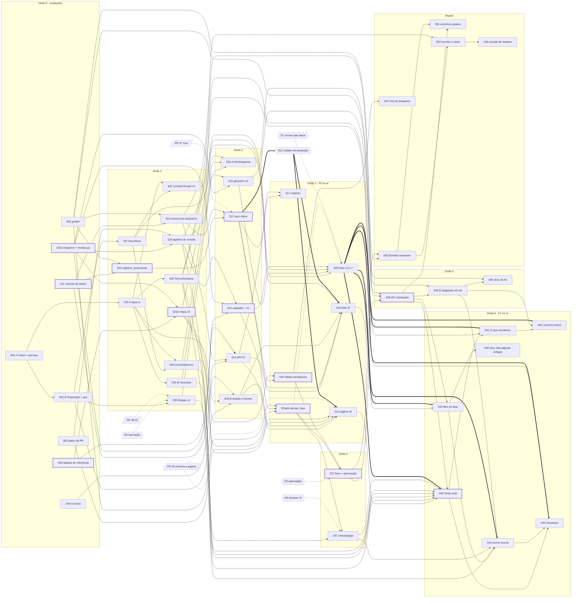

# Spec 013 — Tramitação: onde está, o que aconteceu, o que vem depois

**Data:** 2026-10-30
**Estado:** backlog proposto, aguardando revisão da maintainer. Nada aqui
está decidido; as decisões pendentes estão em §10.2, cada uma com uma
recomendação.
**Discovery:** [docs/DISCOVERY-TRAMITACAO.md](../../docs/DISCOVERY-TRAMITACAO.md) (PR #50)
**Arquivos irmãos:**
[backlog-dados.md](backlog-dados.md) (Arquitetura) ·
[backlog-design-system.md](backlog-design-system.md) (Design System) ·
[backlog-interface.md](backlog-interface.md) (UI/UX)
**Este arquivo (Product):** problema, objetivos, princípios, o índice e a
sequência do backlog inteiro, o processo de revisão do mapa e do glossário
(TRM-023 e TRM-029), os gates de revisão de interface, DoR/DoD, as specs de
TRM-003, TRM-017, TRM-047 e TRM-054, riscos e decisões, e o estado da
revisão cruzada com o que falta para a maintainer (§11). Índice, ondas e
dependências consolidados com os outros três arquivos em 2026-10-30.
**Substitui (se D7 for aceita):** F-001, F-003, F-007 e F-008 de
`specs/012-enriquecimento-dados-proposicoes/spec.md`. F-002 e F-004 a F-006
continuam valendo lá.

Convenções: os números do banco são do ambiente de desenvolvimento (240
proposições), como no discovery. "Acompanhadas" = proposições que estão no
banco do ZIL. Seções do discovery são citadas como "disc. §N".

---

## 1. Problema e oportunidade

### 1.1 As perguntas do cidadão

| Pergunta | Hoje | Depois deste backlog |
| --- | --- | --- |
| **Onde está?** | Situação crua, às vezes nula, truncada num Selo | Fase em linguagem simples, Casa, órgão, "desde", situação oficial inteira e "Ver na Câmara ↗" |
| **O que aconteceu até aqui?** | Nada; o kit tem `LinhaDoTempo` e nenhuma página usa | Linha do tempo com até 8 marcos e todos os registros recolhíveis |
| **O que vem depois?** | Nada | A próxima etapa do rito — nunca *quando*, salvo evento marcado ou prazo legal (Depois: TRM-051) |
| **Como uma proposição vira lei?** | Nada | `/como-vira-lei`: rito por espécie e Casa iniciadora, desfechos, apensação |
| **O que significa esta situação?** | Nada; "Aguardando Despacho do Presidente da Câmara" é lido como "esperando sanção" (disc. §1.1) | Glossário revisado, termo a termo, e definição inline |

### 1.2 O estado atual, com evidência

- **As 5 proposições do placar estão sem status, e 4 já viraram lei**
  (PL 327/2021 → Lei 15.103/2025; PL 2/2024 → Lei 14.871/2024;
  PL 528/2020 → Lei 14.993/2024; PL 1847/2024 → Lei 14.973/2024). Causa:
  `scripts/sync_votacoes_zil.py:113-142` e `_upsert_proposicao`
  (`apps/workers/crawlers/camara.py:61-103`) criam a proposição sem buscar o
  detalhe (disc. §1.2).
- **21 de 240 sem situação**: 5 pelo defeito acima, 16 porque a API devolve
  nula para projeto recém-apresentado (29% dos PLs de 2026; disc. §1.2).
- **Nada atualiza a situação depois da criação.** O que aparece é a foto do
  dia em que a proposição entrou no banco (disc. "Respostas curtas").
- **A página mostra a situação crua num `Selo` que trunca**
  (`apps/web/app/proposicoes/[id]/page.tsx:148`; lista em
  `apps/web/app/proposicoes/page.tsx:215`), sem órgão, regime, relator,
  linha do tempo, lei resultante nem link para a página da Câmara.
- **Não existe mapa.** A Câmara tem 99 códigos de situação e 235 tipos de
  tramitação; o Senado, 175 tipos de situação; nenhuma ordem oficial nem
  glossário para o cidadão (disc. §3.1).
- **27 proposições** estão em "Aguardando Despacho do Presidente da Câmara"
  (20 Chancela + 7 Autorização) — a leitura mais provável de um leigo é a
  oposta da real (disc. §1.1).
- `Etapas` pulsa a etapa atual com animação contínua
  (`apps/web/components/ui/Tempo.tsx:62`, `animate-zil-respira`), contra a
  regra do próprio kit.
- A spec 012 já propunha situação estruturada, órgão, relator e lei
  resultante em 2026-04; nada foi implementado (disc. §1.6).

### 1.3 Por que agora

1. **O site está a um passo de ir ao ar.** O deploy está preparado
   (`render.yaml`) e o cron de produção está no PR #47. Sem F0, a primeira
   coisa pública sobre as leis do placar seria um status ausente ou errado.
2. **A eleição passou; a legislatura vai virar.** Os dois turnos foram em
   04/10 e 25/10/2026 (CF 77). A 57ª legislatura termina em 31/01/2027, e o
   fim de legislatura dispara arquivamentos (RISF 332; na Câmara, só para
   quem tramitou três legislaturas completas, RICD 105 com a RCD 33/2022 —
   disc. §2.2). Com o banco congelado na data de criação, essas mudanças
   nunca apareceriam. A audiência pós-eleitoral pergunta "o que o novo
   Congresso vai fazer com isto" — e a resposta começa por "onde está".
3. **Credibilidade é o ativo** (ADR-004). Um erro de fato na página mais
   visível custa mais que qualquer funcionalidade que falte.
4. **Não depende da curadoria das direções.** O gargalo do projeto é a
   curadoria de `direcao_esperada` (ADR-004). Este backlog entrega valor com
   zero direções novas. O mapa e o glossário também são curadoria, mas
   **limitada** (112 entradas na v1, §6.12) e feita uma vez, com manutenção
   periódica.

### 1.4 A oportunidade

Responder às cinco perguntas com texto **rastreável** (cada fase diz qual
regra e qual versão do mapa a produziram), **determinístico** (template, não
LLM) e **revisado** (nenhuma entrada vai ao ar sem aprovação). As páginas
explicativas (`/como-vira-lei`) servem a qualquer proposição, não só às do
placar — conteúdo de educação cívica que não envelhece com o ciclo de
votações.

---

## 2. Objetivos e métricas

Todas verificáveis sem julgamento. "Como medir" aponta o comando ou o teste
que dá o número; o relatório de TRM-017 reúne os que dependem do banco.

| # | Métrica | Meta | Fase | Como medir |
| --- | --- | --- | --- | --- |
| M1 | Proposições do placar com situação igual à da Câmara | 5 de 5 | F0 | `scripts/relatorio_tramitacao.py --verificar-api --placar` |
| M2 | Situação nula no banco só quando a API devolve nula | 100% | F0 | idem, `--verificar-api` |
| M3 | Proposições da Câmara com `url_camara` na API | 100% | F0 | relatório + teste de contrato (TRM-014) |
| M4 | Criar proposição a partir de votação busca o detalhe | teste existe e passa | F0 | `pytest tests/unit -k registrar_proposicao` (TRM-010) |
| M5 | Acompanhadas com fase conhecida — `nao_sabemos` abaixo de 5%. Recém-apresentada é fase conhecida (`fase: apresentada` + `fase_motivo: recem_apresentada`, R9a), não `nao_sabemos` | < 5% | F1, depois do lote L2 | relatório (TRM-017), com a distribuição por motivo; viabilidade conferida antes dos lotes pela projeção de TRM-027 (sem o órgão efetivo na R7 e a R9 pelo histórico, seria ≈ 17% — backlog-dados A19, A20) |
| M6 | `nao_sabemos(mapa_nao_aprovado)` nas 5 espécies, com o mapa v1 aprovado | 0 | F1 | relatório |
| M7 | Entradas do mapa ou do glossário publicadas sem `aprovado` | 0 | sempre | validador (TRM-024) + teste de contrato de `/tramitacao/mapa` (TRM-028) |
| M8 | Fases exibidas com "Como sabemos" | 100% | F1 | teste de contrato (`como_sabemos` não nulo quando `fase` não nula) |
| M9 | Cobertura de códigos dos snapshots | 100% mapeados ou em `nao_mapeados` com motivo | F1 | job da CI (TRM-024) |
| M10 | Golden fixtures passando | ≥ 12, todas verdes, ≥ 1 por espécie | F1 | `pytest tests/unit -k golden` (TRM-025) |
| M11 | Violações axe nas rotas tocadas, 375/768/1280 × 2 temas | 0 | todo PR de UI | job de a11y da CI (TRM-001) |
| M12 | Duração do passo diário (janela D-7) | < 5 min | F1 | `IngestionRun` do passo `tramitacao` (TRM-012), lido pelo relatório |
| M13 | Movimentadas com `detalhe_sincronizado_em` ≤ 24 h | 100% | F0 | relatório (latência < 24 h é meta do PRD §3.1) |
| M14 | Tempo da maintainer por lote de revisão | ≤ 60 min (meta) | F1 | `--minutos` registrado em `decisao.yml` (§6.7) |
| M15 | Datas futuras publicadas sem evento ou prazo legal com fonte | 0 | F2 | teste de contrato (TRM-051) |

**Validação qualitativa (recomendada, não bloqueante).** Antes de anunciar
F1: cinco pessoas sem formação jurídica leem "Onde está agora" de três
proposições (uma em comissão, uma em "Chancela", uma que virou lei) e dizem
onde está e o que vem depois. Meta: 4 de 5 acertam as três, e nenhuma lê
"Presidente da Câmara" como "Presidente da República". Registro em
`docs/` com as respostas literais.

**O que NÃO é objetivo**

- Prever quando uma proposição será votada, ou dizer que "deve andar em breve".
- Avaliar se uma lei funcionou (só a escada honesta de TRM-054, no Depois).
- Glossário das 99 situações na v1: a v1 cobre as presentes no banco (§6.11);
  as demais aparecem como "sem explicação ainda".
- PLN (orçamento): `nao_sabemos(especie_fora_do_escopo)`.
- Ser fonte oficial: o ZIL sempre aponta para a Câmara e o Senado.
- Métricas de audiência: o site está com `noindex`, e medir tráfego não muda
  nenhuma decisão deste backlog.

---

## 3. Princípios de produto deste tema

1. **Não estimar datas.** A ordem das etapas é norma; o momento é
   discricionário (disc. "Respostas curtas"). Data futura só com evento
   agendado ou prazo D com início oficial e fonte; sem calendário de
   feriados confiável, nunca calcular data final de prazo em dias úteis.
2. **Separar fase de pós-lei.** `fase` é linear; vigência, vetos e
   regulamentação são atributos (`pos_lei`). Nada de "% concluída" nem de
   regulamentação como etapa — lei autoaplicável não está "incompleta".
3. **Proveniência visível.** Toda fase tem "Como sabemos" (regra, versão do
   mapa, fontes, data da conferência); a situação oficial aparece sempre
   inteira, ao lado da nossa leitura, com "Ver na Câmara ↗".
4. **Linguagem simples sem perder exatidão.** O termo oficial nunca some; o
   texto do ZIL é marcado como "texto do ZIL, não oficial". Quando
   simplicidade e exatidão divergem, vence a exatidão (§6.6).
5. **Fase sem matiz.** `zil-alinhado` e `zil-contra` dizem alinhamento com a
   posição ZIL, e `zil-neutro` (âmbar) diz "não validado"; fase, desfecho e
   `nao_sabemos` usam só texto, superfícies e forma (S4). Desfecho não é
   fracasso: "Arquivada" não é vermelho.
6. **Na dúvida, `nao_sabemos`** — com motivo, nunca palpite. É o espelho do
   "na dúvida, não classificar" das direções.
7. **Nada vai ao ar sem aprovação, e a máquina não escreve status em
   tempo de execução.** Só entradas `aprovado` são publicadas; a frase de
   "Onde está" sai de template.
8. **Neutralidade temporal.** "Última movimentação em dd/mm/aaaa", nunca
   "parada há N dias".
9. **O frontend não deriva nada.** Fase, rótulo e frase vêm da API
   (API-first, PRD §5.2).
10. **Honestidade sobre o processo.** Revisão por agentes de IA reduz erro;
    não é revisão independente. O site diz isso (GOVERNANCE, P4; TRM-047).

---

## 4. Índice do backlog

Ordem = sequência de execução (onda, depois dependência). Horizonte: P0/P1 =
Agora, P2 = Em seguida, P3 = Depois. Estimativa: P ≤ ½ dia, M 1–2 dias,
G 3+ dias (quebrar). Arquivo: onde está a spec detalhada — `dados` =
backlog-dados.md, `ds` = backlog-design-system.md, `interface` =
backlog-interface.md, `spec` = este arquivo. **Negrito** = tarefa criada
fora do esqueleto (003, 017, 029, 047 por este arquivo; 037, 038 pelo Design
System). Linhas com sufixo (001-A, 021a…) são os PRs em que o dono quebrou
a tarefa; o ID continua o mesmo. "Pub.:" = gate de publicação — o código
pode mergear antes; o conteúdo só aparece depois.

Consolidado em 2026-10-30 a partir dos quatro arquivos, depois da revisão
cruzada (`revisoes/`). Estimativas e dependências são as do dono de cada
spec.

| Onda | ID | Título | Épico | Prior. | Horiz. | Est. | Dono | Depende de | Arquivo |
| --- | --- | --- | --- | --- | --- | --- | --- | --- | --- |
| 0 | **TRM-003** | Gates de revisão: template de PR, checklists e agentes revisores (UI/UX, DS, Arquitetura) | E0 | P0 | Agora | P | Product | — | spec §9.1 |
| 0 | TRM-001-A | Infra de testes do frontend, parte A: Vitest + Testing Library + jest-axe + job `test-frontend` | E0 | P0 | Agora | M | Design System | — (base: `main` depois do #50) | ds |
| 0 | TRM-001-B | Parte B: Playwright + axe (375/768/1280 × 2 temas, `reflow-320`) + vitrine `/kit` + API falsa com CORS + job `e2e-frontend` | E0 | P0 | Agora | M | Design System | 001-A | ds |
| 0 | TRM-002 | Fixtures gravadas das APIs (golden) + replay | E0 | P0 | Agora | M | Arquitetura | — | dados |
| 0 | TRM-011 | Persistir `statusProposicao` completo, com órgão efetivo (migration) | E1 | P0 | Agora | P | Arquitetura | — | dados |
| 0 | TRM-020 | Snapshots das tabelas de referência + script de atualização com diff + `nao_mapeados.yml` | E2 | P0 | Agora | P | Arquitetura | — | dados |
| 0 | TRM-021a | Mapa, parte a: esquema, carga, `packages/tramitacao/revisao.py` (`hash_entrada`, `entradas_publicaveis`), esqueleto | E2 | P0 | Agora | M | Arquitetura | — (só esquema) | dados |
| 0 | TRM-046-A | Matriz de estados e textos, parte A: `textos.ts`, espécies, campos de F0 de `Proposicao` | E4 | P1 | Agora | P | UI/UX | contratos do brief | interface |
| 1 | TRM-010 | `registrar_proposicao` único, sempre com detalhe | E1 | P0 | Agora | M | Arquitetura | 011, 002 | dados |
| 1 | TRM-013 | Norma resultante pelo despacho + URN e links | E1 | P0 | Agora | P | Arquitetura | 011, 002 | dados |
| 1 | TRM-021b | Mapa, parte b: conteúdo-rascunho v0 com base legal (fases, marcos, ritos) | E2 | P0 | Agora | M | Arquitetura | 020, 021a | dados |
| 1 | TRM-023 | Processo e pipeline de revisão do mapa e do glossário | E2 | P0 | Agora | M | Product | 021a, 003 | spec §6 |
| 1 | **TRM-037** | `Recolhivel` (o `<details>` do kit) + `scroll-padding` global | E3 | P1 | Agora | P | Design System | 001-B, 003 | ds |
| 1 | TRM-031-A | `FaseSelo`, parte A: `lib/tramitacao/tipos.ts` | E3 | P1 | Agora | P | Design System | 001-A, 003 | ds |
| 1 | TRM-030 | `Etapas` v2 | E3 | P1 | Agora | M | Design System | 001-B, 003, D6, PR #48 | ds |
| 1 | TRM-031-B | `FaseSelo` + desfecho (sem matiz), `Selo`, ícones | E3 | P1 | Agora | M | Design System | 031-A, 001-B, 003 | ds |
| 1 | TRM-035 | `TermoGlossario` + `GlossarioLista` | E3 | P1 | Agora | M | Design System | 001-B, 003, 031-A | ds |
| 1 | TRM-032 | `LinhaDoTempo`/`Marco` v2 + `TodosOsRegistros` | E3 | P1 | Agora | M | Design System | 001-B, 003, 037, 031-A | ds |
| 1 | TRM-033 | `ComoSabemos` + `dataBR` | E3 | P1 | Agora | P | Design System | 001-B, 003, 037, 031-A | ds |
| 2 | TRM-012 | `scripts/sync_tramitacao.py` (D-7 ∩ acompanhadas + reconciliação) | E1 | P0 | Agora | M | Arquitetura | 010, 011, 013; PR #47 só para ligar ao `agenda.py` | dados |
| 2 | TRM-014 | API: `ProposicaoRead` com os campos novos, `url_camara`, órgão efetivo, `X-Total-Count` | E1 | P0 | Agora | P | Arquitetura | 011, 013, 021a (carregador do glossário, textos de regime); PR #49 | dados |
| 2 | TRM-024 | `validar_tramitacao.py` + cobertura + CI (V-E, V-C; V-R de §6.9) | E2 | P0 | Agora | M | Arquitetura | 020, 021a; 023 (formato, para V-R) | dados |
| 2 | TRM-022 | Glossário v0 + guia de redação — PR 1: L0 (10 regimes e apreciações) | E2 | P0 | Agora | M (dois PRs) | UI/UX | 020, 021a, 023; merge depois de 024 | interface |
| 2 | TRM-034-A | `RitoDiagrama`: componente + vitrine + testes, com dados de exemplo | E3 | P1 | Agora | M | Design System | 001-B, 003, 030, 031-B, 037 | ds |
| 2 | TRM-046-B | Matriz, parte B: estado, cliente da API, fixtures, harness da matriz | E4 | P1 | Agora | P–M | UI/UX | 001-B, 031-A, 046-A; contrato de 028 escrito (não implementado). A troca para as fixtures geradas por 028 é passo de acompanhamento, depois de 028 | interface |
| 3 | TRM-015 | Página da proposição v0 | E1 | P0 | Agora | M | UI/UX | 014, 013, 046-A, 046-B, 033, 001-B, 003; 037 opcional; PR #49; L0 opcional. **Pub.:** 012 executado em produção (`completo`, 5 do placar conferidas) | interface |
| 3 | TRM-016 | Lista v0: situação sem truncar + "Última movimentação em" + ordenação | E1 | P1 | Agora | P | UI/UX | 014, 012, 046-A, 046-B, 033, 001-B, 003. **Pub.:** como 015 | interface |
| 3 | **TRM-017** | Relatório de saúde da tramitação (métricas M1–M14) | E1 | P1 | Agora | P | Product | 012, 014; 027 para as métricas de fase | spec §9.2 |
| 3 | TRM-025a | Motor `derivar_fase`, parte a: tipos, regras R0–R10 (R7 com órgão efetivo; R9 pelo histórico), testes sintéticos | E2 | P1 | Agora | M | Arquitetura | 021b, 024, 002 | dados |
| 3 | TRM-025b | Motor, parte b: `montar_entrada` + golden + determinismo | E2 | P1 | Agora | M | Arquitetura | 025a | dados |
| 3 | TRM-026 | Tabela `tramitacoes` + ingestão do histórico + marcos | E2 | P1 | Agora | M | Arquitetura | 011, 012, 021b | dados |
| 3 | TRM-022 | Glossário v0 — PR 2: L4 (18 situações) e entradas `fase_*`, `desfecho_*`, `apensada`, `especie_*` | E2 | P0 | Agora | (incl. acima) | UI/UX | PR 1 de 022 | interface |
| 3 | **TRM-029** | Rodadas de revisão do mapa e glossário v1 (lotes L0–L7) até a aprovação | E2 | P0 | Agora | M (+ ≤ 8 h da maintainer) | Product | 021b, 022, 023, 024; 025 para L2–L3; D1 para L1 e L7 | spec §6.13 |
| 4 | TRM-027 | Fase persistida + cadeia de apensação + recálculo | E2 | P1 | Agora | M | Arquitetura | 025b, 026, D2; PR #47 só para o workflow de recálculo | dados |
| 4 | **TRM-047** | `/metodologia#tramitacao`: como derivamos a fase e revisamos o mapa | E4 | P1 | Agora | P | Product | 023, 025a, 001-B, 003, D9 | spec §9.3 |
| 5 | TRM-028 | API: `/proposicoes/{id}/tramitacao`, `/eventos`, `/tramitacao/mapa`, contagem, filtro `fase`, gerador de fixtures do frontend | E2 | P1 | Agora | M | Arquitetura | 027, 022, 002 | dados |
| 5 | TRM-034-B | `RitoDiagrama`: tipos do mapa e adaptador `ritoParaDiagrama` | E3 | P1 | Agora | P–M | Design System | 034-A, 028, 031-A | ds |
| 5 | TRM-036 | Documentação do kit + proposta ao ZIL Interface | E3 | P2 | Em seguida | M | Design System | 003, 030–035 (034-B incluída), 037 | ds |
| 6 | TRM-040 | "Onde está agora" v1 | E4 | P1 | Agora | M | UI/UX | 028, 027, 030, 031-B, 033, 035, 037, 046-B, 047, 015. **Pub.:** L1–L3 | interface |
| 6 | TRM-043 | Lista: selo e filtro de fase com contagem | E4 | P2 | Em seguida | M | UI/UX | 016, 028, 031-B, 046-B. **Pub.:** L1–L2 | interface |
| 6 | TRM-041 | "O que aconteceu" (linha do tempo) | E4 | P1 | Agora | M | UI/UX | 040, 028, 026, 032, 037, 046-B. **Pub.:** L3 | interface |
| 6 | TRM-044 | `/como-vira-lei` | E4 | P2 | Em seguida | M | UI/UX | 043, 034-A, 034-B, 035, 028, 046-B, 047. **Pub.:** L5–L6 | interface |
| 6 | TRM-042 | "O caminho inteiro" (rito da espécie) | E4 | P2 | Em seguida | P | UI/UX | 041, 034-A, 034-B, 037, 028, 046-B. **Pub.:** L5–L6 | interface |
| 6 | TRM-045 | `/como-vira-lei/situacoes` + termos inline | E4 | P2 | Em seguida | M | UI/UX | 040, 044, 035, 031-B, 028, 022, 046-B. **Pub.:** L0, L4, L7 | interface |
| 6 | **TRM-038** | Zerar as violações de a11y conhecidas das páginas existentes | E3 | P2 | Em seguida | M | Design System | 001-B; depois de 015, 016 e, para `/proposicoes`, de 043 | ds |
| D | TRM-050 | Migração do `senado_client` para `/processo*` e `/votacao` | E5 | P3 | Depois | G (quebrar: cliente; votações; vínculo e fase) | Arquitetura | 002, 012, 026, 027 | dados |
| D | TRM-052 | Rota prevista pelo despacho (parser) | E5 | P3 | Depois | G | Arquitetura | 011, 026 | dados |
| D | TRM-051 | Próximos passos agendados (eventos + pauta) | E5 | P3 | Depois | G (quebrar: Câmara; Senado; prazos) | Arquitetura | 028; 050 para o Senado | dados |
| D | TRM-053 | Normas, vetos e regulamentação | E5 | P3 | Depois | G (quebrar: tabelas; vetos; regulamentação) | Arquitetura | 050, 013, D4 | dados |
| D | TRM-054 | Escada de impacto (execução e avaliação) | E5 | P3 | Depois | G (quebrar por degrau) | Product | 053, 050, D4, ADR-008 | spec §9.4 |

Total: 43 tarefas (37 do esqueleto + 003, 017, 029, 047 deste arquivo +
037, 038 do Design System), em 51 linhas de PR.

---

## 5. Sequenciamento e caminho crítico

### 5.1 Ondas

Uma onda começa quando as dependências **mergeadas** dela existem. Dentro
de uma onda, cada linha pode ir para um agente diferente, em worktree
própria (§8.3).

| Onda | Em paralelo (→ = em sequência no mesmo agente) | Agentes | Entrega visível ao fim da onda |
| --- | --- | --- | --- |
| 0 | 001-A → 001-B; 002; 003; 011; 020; 021a; 046-A + decisões D1, D2, D6–D9, D12, D13 | 1 DS, 2 Arquitetura, 1 Product, 1 UI/UX | Nenhuma; fundações e decisões |
| 1 | 010 → 013; 021b; 023; DS agente 1: 037 → 030 → 032; DS agente 2: 031-A → 031-B → 035 → 033 | 2 Arquitetura, 1 Product, 2 DS | Proposições do placar com situação (via `registrar_proposicao`) |
| 2 | 012; 014; 024; 022 (PR 1, L0); 034-A; 046-B | 2 Arquitetura, 1 UI/UX, 1 DS | API F0 completa (situação, órgão efetivo, `url_camara`); mapa validado na CI |
| 3 | 015 e 016 (dois agentes); 017; 025a → 025b; 026; 022 (PR 2, L4 e textos de fase); 029 (L0 já; L1 e L7 com D1; L4 com o PR 2 de 022; L2–L3 depois de 025) | 2 UI/UX, 2 Arquitetura, 1 Product + maintainer | **F0 no ar** quando 012 rodar em produção (`completo`, 5 do placar conferidas) |
| 4 | 027; 047; 029 (L2–L3) | 1 Arquitetura, 1 Product + maintainer | Fases recalculadas no banco; metodologia explica o método |
| 5 | 028; 034-B → 036 | 1 Arquitetura, 1 DS | API de tramitação e fixtures geradas para o frontend; troca de fixtures de 046-B |
| 6 | Agente A: 040 → 041 → 042; agente B: 043 → 044 → 045; 038 depois de 043 | 2 UI/UX, 1 DS | **F1 no ar** (fase, etapas, linha do tempo), conforme os lotes; depois `/como-vira-lei` |
| D | 050 → 053 → 054; 052; 051 | Arquitetura, Product | F2–F5 do discovery |

### 5.2 Caminho crítico

- **Até F0 (o erro mais visível):** dados — 011 → 010 → 012 e
  011 → 013 → 014 (com 021a, que dá o carregador dos textos de regime);
  interface — 001-A → 001-B → 037 → 033 (`dataBR`) e 001-B → 046-B, que
  convergem em 015 e 016. **Gate de publicação:** 012 executado em produção
  (`completo`, as 5 do placar conferidas); sem isso as 240 sairiam
  `nao_sincronizada` e a página v0 iria ao ar sem resolver o erro (D10). Se
  a interface atrasar, 010–014 vão ao ar sozinhos: o Selo atual passa a
  mostrar a situação correta, ainda que truncada.
- **Até a fase publicada (F1):** 020 → 021b → 024 → 025a → 025b → 027 →
  028 → 040, com 011 → 012 → 026 → 027 juntando-se em 027. É a cadeia mais
  longa (P + M + M + M + M + M + M + M). Do lado do kit, 037 → 033 e
  031-A → 035 chegam bem antes.
- **O gargalo de calendário é humano, não técnico:** TRM-029. A fase só
  aparece quando L1–L3 estiverem aprovados, e a meta M5 só pode ser medida
  depois do L2 (órgão efetivo e R9 pelo histórico estão nas regras R7 e R9).
  A maintainer lê cada lote a frio, no dia seguinte à revisão (GOVERNANCE,
  P2). Por isso L0, L1, L4 e L7 começam na onda 3, antes de 025 existir, e a
  interface é construída contra `nao_sabemos(mapa_nao_aprovado)` enquanto os
  lotes não chegam — a publicação incremental é segura por construção (§6.8).

### 5.3 Dependências externas

| PR | O que muda aqui | Regra |
| --- | --- | --- |
| #47 `047-deploy-cron` | `scripts/agenda.py` e `dados.yml` | TRM-012 e TRM-020 funcionam como script próprio; ligar ao `agenda.py` é o último passo, depois do merge do #47. TRM-017 vira passo semanal depois do #47 |
| #48 `048-hemiciclo` | Componentes novos no kit, `index.ts` e README do kit | Mergear antes de 030–035, ou rebasear neles: conflito garantido em `components/ui/index.ts` e no README |
| #49 `049-recusa-resumo` | `proposicoes/[id]/page.tsx`, `ProposicaoRead` | Mergear antes de TRM-014 (mesmo schema; preservar o `model_validator`) e de TRM-015 (mesmo arquivo) |
| #50 (este discovery) | `docs/DISCOVERY-TRAMITACAO.md`, este diretório | Branch base de todas as tarefas é `main` depois do merge do #50 |

### 5.4 Arquivos quentes (uma tarefa por vez)

| Arquivo | Ordem |
| --- | --- |
| Migrations Alembic (cadeia linear de heads) | 011 → 026 → 027 (→ 050 → 053) |
| `apps/api/models/__init__.py`, `apps/api/schemas/__init__.py` | #49 → 011 → 014 → 026 → 027 → 028 |
| `apps/api/routers/legislativo.py` | #48/#49 → 014 → 028 |
| `packages/camara_client/__init__.py` | 002 → 012 |
| `apps/workers/tramitacao/sincronizacao.py` | 012 → 013 → 026 → 027 |
| `apps/web/app/proposicoes/[id]/page.tsx` | #49 → 015 → 040 |
| `apps/web/components/tramitacao/TramitacaoProposicao.tsx` | 040 → 041 → 042 |
| `apps/web/components/tramitacao/OndeEsta.tsx` | 040 → 045 |
| `apps/web/components/tramitacao/ComoViraLei.tsx` | 044 → 045 |
| `apps/web/app/proposicoes/page.tsx` e componentes da lista | 016 → 043 → 038 |
| `apps/web/components/ui/index.ts`, README do kit, `app/kit/page.tsx` | #48 → 037 → 030 → 031 → 032 → 033 → 035 → 034 → 036 (PRs pequenos; rebase a cada merge) |
| `apps/web/lib/tramitacao/textos.ts`, `apps/web/tests/e2e/matriz.ts` | 046-A → cada tarefa acrescenta as suas linhas |
| `data/tramitacao/glossario.yml` | 022 (PR 1) → 022 (PR 2) → lotes de 029 |
| `data/tramitacao/revisao.yml` | só os scripts de TRM-023 escrevem; um lote por vez em PR aberto |
| `data/tramitacao/nao_mapeados.yml` | só o script de TRM-020 reescreve; à mão, só para mover código para uma regra |

### 5.5 Diagrama de dependências

Seta cheia = depende; tracejada = dependência externa ou decisão; seta
grossa = gate de publicação (o código pode mergear antes; o conteúdo só
aparece depois da aprovação). Borda grossa = caminho crítico.



---

## 6. Processo de discovery e revisão do mapa de fases e do glossário

Esta seção é a spec de TRM-023 (processo e ferramentas) e de TRM-029 (a
execução, lote a lote). As regras de §6.8 e §6.9 são contrato: TRM-021,
TRM-022, TRM-024, TRM-025 e TRM-028 as implementam do lado deles.

### TRM-023 — Processo e pipeline de revisão do mapa e do glossário

**Épico:** E2 Mapa e glossário · **Prioridade:** P0 · **Horizonte:** Agora · **Estimativa:** M
**Dono da spec:** Product · **Revisões obrigatórias:** Arquitetura (pipeline, scripts, regras do validador); Maintainer (é norma editorial)
**Depende de:** TRM-021a (esquema, chaves e `packages/tramitacao/revisao.py`), TRM-003 (template de PR) · **Desbloqueia:** TRM-022, TRM-024 (regras V-R), TRM-029, TRM-047; publicação de TRM-040 a TRM-045

**Problema**

- O mapa e o glossário decidem o que o site diz sobre **toda** proposição
  numa dada situação. Não há ordem oficial nem glossário cidadão para os 99
  códigos de situação e 235 de tramitação (disc. §3.1, §4.4). Um erro numa
  entrada se repete em cada proposição que cai nela.
- O texto mais lido hoje leva ao erro oposto: "Aguardando Despacho do
  Presidente da Câmara" (27 proposições) parece "esperando sanção".
- Há uma maintainer. A norma de duas aprovações para `data/` não é cumprida,
  e o que vale são as obrigações P1–P4 da GOVERNANCE ("Estado atual"). O
  discovery pede revisão "idealmente com alguém de formação legislativa"
  (disc. §8, decisão 5) — que o projeto não tem.
- Sem um gate no código, "rascunho" e "publicado" são o mesmo arquivo.

**Oportunidade** — Revisar é mais rápido que pesquisar. Agentes com
instruções públicas e versionadas fazem a verificação mecânica e adversarial;
a maintainer decide a frio sobre um relatório legível, entrada por entrada;
o código garante que só o aprovado vai ao ar. Publicação incremental: cada
lote aprovado acende sozinho a parte da interface que depende dele.

**Solução**

#### 6.1 O fluxo

```
redator (agente)          revisores (4 agentes,            maintainer                site
fontes canônicas  ──►     independentes, instruções  ──►   relatório a frio   ──►   só `aprovado`
base legal + URL          versionadas)                     aprova por script        com hash conferido
   rascunho                  revisado_agentes                 aprovado
      ▲                            │ bloqueia
      └────────── correção (≤ 3 rodadas; depois, divergência para a maintainer)
```

#### 6.2 Unidade de revisão e estados

A unidade é a **entrada**, identificada por `<arquivo>/<chave>`:

| Arquivo | Entrada | Exemplo de chave |
| --- | --- | --- |
| `fases.yml` | cada fase, desfecho, `apensada`, cada regra R1–R10 | `fases/fase_comissoes`, `fases/desfecho_arquivada`, `fases/regra_R7` |
| `marcos.yml` | cada `codTipoTramitacao` mapeado | `marcos/320` |
| `ritos.yml` | cada rito (espécie × Casa iniciadora), revisado inteiro | `ritos/PL_CD`, `ritos/PEC_SF`, `ritos/MPV_CN` |
| `glossario.yml` | cada termo (situação, regime, apreciação, fase, desfecho) | `glossario/aguardando_despacho_chancela` |

Os nomes exatos das chaves são de TRM-021/TRM-022; o formato
`<arquivo>/<chave>` é o contrato.

Estados (contrato do brief): `rascunho` → `revisado_agentes` → `aprovado`.
Entrada sem registro de revisão é `rascunho`. **`nao_mapeados` não passa por
aprovação**: é o caminho conservador (vira `nao_sabemos`). Mora em
`data/tramitacao/nao_mapeados.yml`, reescrito pelo script de TRM-020 (código
novo entra com `motivo: codigo_novo_AAAA-MM-DD`); à mão, só para tirar um
código de lá e levá-lo a uma regra, o que cria entrada nova a revisar. Os
`ignorados` de `marcos.yml` ("não é marco", com nota) seguem a mesma regra.
**As situações oficiais mapeadas moram dentro das regras**
(`fases/regra_R7` etc., backlog-dados §2.1-3): revisar a regra é revisar
cada situação que ela trata.

O estado **não** mora nos arquivos de conteúdo, e sim em
`data/tramitacao/revisao.yml`, escrito só pelos scripts:

```yaml
# Estado de revisão de data/tramitacao/. Escrito por scripts/revisar_tramitacao.py
# e scripts/aprovar_tramitacao.py. Não editar à mão: o validador confere o hash.
versao_publicada: 4          # int; sobe a cada aprovação; vai a `como_sabemos.versao_publicada`
publicada_em: 2026-11-12
entradas:
  glossario/regime_urgencia:
    estado: aprovado
    hash: 3f9a0c1d2e4b       # 12 hex do sha256 do conteúdo canônico da entrada
    registros: [L0]          # lotes em data/tramitacao/revisoes/
    aprovado_em: 2026-11-06
    revisado_por:            # escrito pelos scripts (backlog-dados §2.8)
      - "agente:juridico@1a2b3c4d"
      - "agente:linguagem@5e6f7a8b"
      - "agente:dados@9c0d1e2f"
      - "agente:adversarial@3a4b5c6d"
      - "maintainer:Melissa de Britto"
```

O esquema Pydantic deste arquivo (`EstadoEntrada`, `ArquivoRevisao`) está
em backlog-dados §2.8.

Por quê, num arquivo à parte: (1) o PR de aprovação muda só linhas de estado,
o que torna o ato da maintainer trivial de auditar; (2) editar o conteúdo não
exige tocar o estado — o hash deixa de bater e a entrada deixa de ser
publicável sozinha; (3) dispensa biblioteca de YAML que preserve comentários
(o repositório só tem `pyyaml`).

**Hash canônico:** `hash_entrada(entrada: dict) -> str` =
`sha256(json.dumps(entrada, sort_keys=True, ensure_ascii=False, separators=(",", ":")).encode("utf-8")).hexdigest()[:12]`,
sobre o mapeamento da entrada como o `yaml.safe_load` devolve. Mora em
**`packages/tramitacao/revisao.py`** (implementado em TRM-021a), reexportado
em `apps/workers/tramitacao/revisao.py`, e é a **única** implementação,
usada pelo validador, pela API e por `derivar_fase`. Em `packages/` porque
a API no container não enxerga `apps.workers` (backlog-dados §0).

#### 6.3 Como o rascunho é produzido (o discovery de cada entrada)

O redator é o agente que implementa TRM-021/TRM-022 (primeiro rascunho) e
TRM-029 (correções). Regras:

1. **Só fontes canônicas**, nesta ordem: CF; RICD; RISF; RCN 1/2002; LC
   95/1998; LINDB; Decreto 12.002/2024; páginas institucionais "Entenda o
   processo legislativo" (Câmara), tramitação de MPV e de veto (Congresso);
   Glossário Legislativo do Congresso **como referência, nunca como texto a
   copiar**. URLs em disc. "Fontes".
2. **Toda entrada** tem `base_legal: [{norma, dispositivo, url}]` não vazia
   **ou** `base_legal_motivo` (≥ 20 caracteres) — este só para critério
   interno do ZIL (ex.: os 90 dias da R9) e para situação administrativa do
   glossário, com o texto padronizado de backlog-interface §2.6; ter os dois
   é erro — e `fontes: [url]`.
3. **Entrada que espelha código oficial** copia `descricao_oficial` do
   snapshot (TRM-020). Se a Câmara mudar a descrição, o hash muda e a
   entrada volta à revisão.
4. **O que não foi conferido na fonte primária** leva
   `pendente: "<o que falta conferir>"` e não sai de `rascunho` (V-R9). O ⚠
   do discovery sobre a "devolução ao autor" está resolvido: RICD art. 137,
   §§ 1º e 2º (conferido no texto compilado em 2026-10-30). Caso pendente
   hoje: a frase sobre desarquivamento no Senado em `desfecho_arquivada`
   (RISF art. 332 — quórum e prazo a conferir no regimento).
   **Atenção:** na Câmara não existe mais desarquivamento a pedido — o
   antigo parágrafo único do RICD art. 105 (hoje § 1º) foi revogado pela RCD
   33/2022. Nenhum texto diz "pode ser desarquivada" sem dizer de qual Casa
   fala.
5. **Casos reais**: cada regra e cada marco cita ao menos uma proposição real
   (id da Câmara) que o exercita, de preferência um golden de TRM-002.
6. **Texto** segue o guia de redação de TRM-022 e os princípios de §3. O
   termo oficial nunca some; a explicação do ZIL é marcada como não oficial.
7. O redator **nunca** escreve em `revisao.yml` nem muda estado.

#### 6.4 Os agentes revisores

Quatro definições em `data/tramitacao/revisores/<nome>.yml`, no formato de
`data/painel/agentes/*.yml` (`agente`, `versao`, `papel`, `vies_declarado`,
`insumos`, `modelo`, `instrucoes`), carregadas por
`apps.workers.agentes.carregar_agente`; o hash das instruções vai para cada
registro. Sob a governança de `data/`: mudar instrução é PR.

**Independência**: como no painel, a assinatura de `montar_prompt` não
recebe o parecer dos outros revisores. **Nenhum revisor busca nada**: o
harness pré-carrega os insumos (como o "contexto pré-registrado" do
ADR-008) e todo texto de fonte passa por `blindar()`.

| Revisor | Pergunta | Insumos pré-carregados | Verifica | `bloqueia` quando |
| --- | --- | --- | --- | --- |
| `juridico` (jurídico-legislativo) | A entrada está correta frente à CF, RICD, RISF, RCN 1/2002, LC 95, LINDB? | a entrada; o trecho de cada `base_legal[].url`, que o harness baixa e recorta pelo dispositivo ("Art. N") | dispositivo existe e diz o que a entrada afirma; quórum e prazo; classe D, D\* ou X; variante da espécie (PEC e PDL sem sanção, MPV → PLV); vigência da norma (RCD 33/2022; Decreto 9.191/2017 revogado) | dispositivo não localizado no texto baixado (`dispositivo_nao_localizado`); afirmação contrária ao dispositivo; regra de uma espécie aplicada a outra; norma revogada citada como vigente |
| `linguagem` (linguagem simples e acessibilidade cognitiva) | Um leigo entende sem errar, e o texto é neutro? | a entrada (rótulo, texto, `texto_curto`); o guia de redação — a §2 de `specs/013-tramitacao/backlog-interface.md`, que o harness recorta do título "## 2. Guia de redação do glossário e dos textos de status" até o próximo "## " e cujo hash vai ao meta; os rótulos já aprovados | uma ideia por frase; sigla expandida na primeira vez; termo técnico explicado; sem dupla negação; consistência com rótulos aprovados; legível por leitor de tela (sem setas ou símbolos soltos) | leitura errada provável (ex.: "Presidente" sem dizer de quê); juízo de valor, alarme ou cobrança ("parada", "engavetada", "travada", "deveria"); data prevista ou "em breve"; sentido que dependa de cor |
| `dados` (cobertura e consistência) | A entrada cobre os códigos certos e acerta os casos gravados? | a entrada; snapshots (TRM-020); `validar_tramitacao.py --cobertura --json`; resultado dos golden (TRM-025, quando existir); distribuição de situações do banco exportada em `data/tramitacao/amostras/situacoes.json` | código → marco certo (ex.: remessa ao Senado como "Expedição de Documento", disc. §3.2-4); armadilhas de disc. §3.2 tratadas; entrada exercitada por algum caso | código mapeado ao marco errado; código citado ausente do snapshot; golden falhando; situação presente no banco sem entrada nem `nao_mapeados` |
| `adversarial` | Existe caso real em que esta entrada leva a uma fase errada? | a entrada; até 10 proposições reais por código ou situação, sorteadas com semente fixa (o hash da entrada) dos arquivos em massa `proposicoes-{ano}` de 2019 a 2026, com `GET /proposicoes/{id}` e `/tramitacoes` baixados e, quando TRM-025 existir, a fase derivada | contradição entre a fase derivada e a evidência bruta; regra que dá palpite onde devia dar `nao_sabemos` | contraexemplo com id e URL da Câmara |

Modelo pinado em cada YAML (`claude-opus-5-5`, o mesmo do painel). Uma
chamada por revisor, por lote, por rodada; a resposta é JSON com um parecer
por chave. Chave ausente na resposta conta como `bloqueia`
(`parecer_ausente`).

Contraexemplo confirmado vira candidato a golden em
`tests/fixtures/tramitacao/candidatos/<id>.json`, gravado pelo utilitário de
TRM-002.

#### 6.5 Formato da revisão

```
data/tramitacao/
  lotes.yml                      # o plano: L0–L7 e as entradas de cada um (§6.12)
  nao_mapeados.yml               # códigos sem tratamento; reescrito pelo script de TRM-020, sem aprovação
  revisao.yml                    # estado por entrada (§6.2)
  revisores/{juridico,linguagem,dados,adversarial}.yml
  revisoes/<lote>/
    rodada-<n>/<revisor>.yml     # parecer bruto + meta (modelo, versão, hash das instruções, uso)
    consolidado.yml              # por entrada: vereditos, estado resultante, hash revisado, divergência
    relatorio.md                 # o que a maintainer lê (§6.7)
    decisao.yml                  # escrito por aprovar_tramitacao.py
```

Parecer por entrada (em `rodada-<n>/<revisor>.yml`):

```yaml
- chave: glossario/aguardando_despacho_chancela
  hash_revisado: 9b1e44c0a7f2
  veredito: ajuste            # ok | ajuste | bloqueia
  achados:
    - tipo: leitura_errada    # vocabulário fechado por revisor, definido no YAML do revisor
      descricao: "'Presidente' sem 'da Câmara' na segunda frase"
      evidencia: {url: null, trecho: null}
      sugestao: "Repetir 'o Presidente da Câmara' na segunda frase."
  casos: []                   # só o adversarial e o dados preenchem
```

`trecho` tem no máximo 25 palavras. `ajuste` não bloqueia; `bloqueia`
precisa de `evidencia` (URL ou caso) — sem evidência, o consolidador rebaixa
para `ajuste` e registra o rebaixamento.

#### 6.6 Consolidação e divergência entre agentes

- Entrada com **algum `bloqueia`** fica `rascunho` e volta ao redator.
- Entrada **só com `ok`/`ajuste`** vira `revisado_agentes`. O redator aplica
  os ajustes que não conflitam antes da última rodada; os que sobram vão ao
  relatório como "sugestões não aplicadas".
- **Qualquer mudança de conteúdo** reabre a entrada para os **quatro**
  revisores na rodada seguinte (é barato e evita que a correção de um crie o
  erro de outro).
- **No máximo 3 rodadas.** Depois disso, `divergencia: true`: o relatório
  mostra as versões lado a lado e a maintainer decide.

Precedência, nesta ordem:

1. **Evidência vence argumento.** Contraexemplo real com URL (`adversarial`,
   `dados`) prevalece sobre opinião de qualquer revisor.
2. **Exatidão vence simplicidade.** Se o `juridico` bloqueia o texto do
   `linguagem`, fica o texto exato; o `linguagem` pode propor nova forma, que
   volta ao `juridico`.
3. **Na dúvida, `nao_sabemos`.** Se o contraexemplo mostra que a regra não
   distingue dois casos, o caso vai para `nao_sabemos(sinais_conflitantes)` em
   vez de a regra escolher um (é o tratamento de "Aguardando Encaminhamento",
   disc. Apêndice A).
4. **O que sobra é da maintainer**, com justificativa escrita (P1).

#### 6.7 A revisão humana da maintainer

**O que ela recebe:** um PR por lote, "Revisão do mapa — lote L<n>", aberto
pelo agente de TRM-029, com o conteúdo, os registros e
`revisoes/<lote>/relatorio.md`. O relatório, gerado e não escrito à mão:

1. **Resumo** — N entradas; quantas prontas, com sugestões, com divergência;
   revisores com versão e hash; modelo; tokens gastos; data da consolidação.
2. **Por entrada**, divergências primeiro:
   - **Como aparece no site** — rótulo e texto exatamente como o leitor verá;
     para regra, a frase de template aplicada a um caso real;
   - **Situação oficial** que a entrada explica, com `descricao_oficial`;
   - **Base legal** com links;
   - **Antes → depois**, quando a entrada já foi aprovada antes;
   - **O que os revisores disseram** — só `ajuste` e `bloqueia`, com evidência;
     `ok` numa linha;
   - **Casos reais testados** — quantos, a fase derivada de cada um, links;
   - **Para decidir** — três perguntas fixas: *Está correto? Um leigo entende
     sem errar? Algo soa como juízo, cobrança ou previsão?*
3. **O comando de aprovação**, pronto para copiar.

**Quanto tempo:** lotes de até 25 entradas; meta de 2 minutos por entrada
sem divergência e 60 minutos por lote (M14). Lote que estoura a meta é sinal
para o relatório melhorar, não para a maintainer ler mais rápido.

**Como aprova:** pelo menos um dia depois da data de `consolidado.yml`
(P2: ler a frio), no branch do PR, num terminal:

```bash
python scripts/aprovar_tramitacao.py --lote L1 --minutos 40
python scripts/aprovar_tramitacao.py --lote L0 --excluir glossario/regime_concessao_radiodifusao --motivo "texto ainda não conferido"
python scripts/aprovar_tramitacao.py --lote L1 --sobrepor glossario/x --justificativa "≥ 40 caracteres, por que o revisor está errado"
```

O script mostra a lista, pede que se digite `APROVO`, e grava `estado:
aprovado`, `hash`, `aprovado_em` (hoje) e o lote em `registros`; sobe
`versao_publicada`; escreve `decisao.yml` (aprovadas, excluídas com motivo,
sobreposições com justificativa, minutos, `aprovado_por` = `git config
user.name`). A maintainer faz o commit (`data: aprova lote L1 do mapa de
tramitação`) e mergeia. **Com sobreposição de `bloqueia`, o merge fica para
o dia seguinte** (P2). Excluídas continuam `revisado_agentes` — no repositório,
fora do ar.

**O que os agentes não fazem:** rodar `aprovar_tramitacao.py` (o script recusa
sem terminal interativo e com `CI` ou `GITHUB_ACTIONS` no ambiente), escrever
`aprovado` em qualquer lugar, mergear.

**O que o site diz:** "Texto do ZIL, não oficial" em cada termo, e o processo
inteiro em `/metodologia#tramitacao` (TRM-047), incluindo que não há revisão
de especialista independente (P4).

#### 6.8 Regras de publicação

1. **Só vai ao ar entrada `aprovado` cujo hash bate com o conteúdo atual.**
   Uma função, `entradas_publicaveis(conteudo, revisao) -> frozenset[str]`,
   em `packages/tramitacao/revisao.py` (TRM-021a; porta única
   `Mapa.publicavel(id)`, backlog-dados §2.1-9), serve à API, a `derivar_fase` e ao
   validador. A conferência acontece **na carga**, não só na CI: conteúdo
   alterado deixa de ser publicado no próximo deploy, antes de qualquer PR
   de revisão.
2. **Fase:** se a regra que casou, a fase ou desfecho resultante, ou o marco
   que a sustentou não for publicável, a saída é
   `nao_sabemos(mapa_nao_aprovado)` (TRM-025).
3. **Glossário:** termo não publicável sai com `texto: null` em
   `/tramitacao/mapa`; a interface mostra "Sem explicação ainda" ao lado da
   situação oficial (texto exato em TRM-046).
4. **Rito:** rito não publicável não aparece em `/como-vira-lei` nem em "O
   caminho inteiro" (texto do estado em TRM-046).
5. **Mudança em entrada `aprovado` ou `revisado_agentes`:** o hash muda, a
   CI falha (V-R3) até o PR trazer a nova revisão dos agentes, e a entrada
   volta a `revisado_agentes` — nunca de `aprovado` para `aprovado` sem
   passar pelos agentes e pela maintainer.
6. **Recalcular depois da aprovação:** o merge em `data/tramitacao/` dispara
   o recálculo das fases (TRM-027; mesmo padrão do workflow `direcoes.yml` do
   PR #47 para `data/direcoes/`). Até lá, o passo diário recalcula.

#### 6.9 Regras do validador (implementadas por TRM-024)

| Regra | Erro quando |
| --- | --- |
| V-R1 | `revisao.yml` cita entrada que não existe nos arquivos de conteúdo |
| V-R2 | `estado` fora de `rascunho`, `revisado_agentes`, `aprovado` |
| V-R3 | `revisado_agentes` ou `aprovado` com `hash` diferente de `hash_entrada` do conteúdo atual — mensagem: "a entrada X mudou depois da revisão; rode `scripts/revisar_tramitacao.py --entradas X`" |
| V-R4 | `revisado_agentes` ou `aprovado` sem `registros`, ou com lote cujo `consolidado.yml` não lista a entrada com o mesmo hash e estado resultante `revisado_agentes` |
| V-R5 | `aprovado` sem `aprovado_em`, com `aprovado_em` no mesmo dia ou antes de `consolidado_em`, ou ausente de `decisao.yml` do lote |
| V-R6 | `aprovado` com `bloqueia` em aberto no consolidado sem sobreposição em `decisao.yml` com justificativa ≥ 40 caracteres |
| V-R7 | entrada sem `base_legal` com URL e sem `base_legal_motivo`; `base_legal_motivo` fora dos dois usos permitidos (critério interno do ZIL, como R9 e R10; situação administrativa do glossário, com o texto padronizado de backlog-interface §2.6); ou os dois juntos |
| V-R8 | `entradas_publicaveis` diverge de "estado `aprovado` e hash igual" (teste unitário, não checagem de arquivo) |
| V-R9 | entrada com `pendente` não vazio em estado diferente de `rascunho` |

Entrada ausente de `revisao.yml` é `rascunho`, sem erro: rascunho pode
existir no repositório.

#### 6.10 Cadência

| Gatilho | O que roda | Quem |
| --- | --- | --- |
| Atualização das tabelas de referência (TRM-020) com código novo | o script de atualização põe o código em `nao_mapeados` com motivo `codigo_novo_AAAA-MM-DD` (CI verde, fase `nao_sabemos`) e cria um lote em `lotes.yml` | agente; a maintainer aprova quando o lote vier |
| Descrição oficial de código mapeado mudou | o hash das entradas que copiam `descricao_oficial` muda; elas saem do ar; lote de revisão | automático + agente |
| Mudança em norma canônica (resolução que altera RICD, RISF ou RCN; emenda constitucional sobre processo legislativo) | `juridico` sobre todas as entradas que citam a norma | a maintainer abre a issue; agente roda |
| Início de cada sessão legislativa (2 de fevereiro, CF 57) | revisão de rotina: os quatro revisores sobre o mapa inteiro; o que mudar vira lote | agente; maintainer |
| Contraexemplo achado em produção (relatório de TRM-017 ou issue) | `adversarial` + `dados` sobre a entrada; o caso vira golden | agente |

#### 6.11 Definição de pronto do mapa v1

O mapa v1 está pronto quando **todas** as condições abaixo valem no `main`:

1. **Fases** (`fases.yml`): as 9 fases, os 7 desfechos (inclusive
   `devolvida`, com base no RICD art. 137) e `apensada`, `aprovado`.
2. **Regras** R1–R10 (disc. §4.3, com os acréscimos de backlog-dados §0.1),
   `aprovado` — inclusive as situações oficiais que cada regra trata, a R7
   pelo **órgão efetivo** (último registro em Plenário ou comissão, A19) e a
   R9 nas duas partes: (a) recém-apresentada e (b) situação nula com
   histórico, pela fase do último marco (A20). R0 é guarda em código, sem
   entrada.
3. **Ritos** (`ritos.yml`): PL, PLP, PEC e PDL com Câmara e com Senado como
   Casa iniciadora, MPV (`MPV_CN`: comissão mista → Câmara → Senado) e o
   bloco `pos_lei`, `aprovado`; cada etapa com base legal e classe de prazo
   (D, D\*, X).
4. **Marcos**: os 25 códigos de disc. §4.4 (apresentação 100; distribuição
   110/112; apensação 106/129/504; relator 320; parecer 322/336; urgência
   196; Plenário 1231/1235/1236/1243; Senado 128/1518/1519; sanção 127/609;
   norma 251/1012/1013; fim 502/200/620), `aprovado` — **exceto o 1236**,
   aceito em `nao_mapeados.yml` com `sem_evidencia` se não houver caso real
   de rejeição de proposição em Plenário: o código também marca rejeição de
   requerimento e de emenda (backlog-dados A6). Decisão D12.
5. **Glossário**: as 10 entradas de regime e apreciação (L0), as 18
   situações de backlog-interface §2.6 (as 16 do banco mais "Aguardando
   Sanção" e "Devolvida ao(à) Autor(a)"), as 9 fases, os 7 desfechos,
   `apensada` e as 5 espécies, `aprovado`; mais toda situação que aparecer
   nas acompanhadas de **produção** na data do corte.
6. **Cobertura**: job da CI verde (M9).
7. **Golden**: os casos de TRM-002 — os 12 do Apêndice B mais os
   acréscimos da Arquitetura, entre eles PLP 68/2024, PEC 45/2019 (que faltavam
   no Apêndice B), PL 3474/2023 (órgão efetivo) e PL 4036/2026 (R9 pelo
   histórico) —, todos verdes (M10), com o `esperado` de cada um conferido
   pela maintainer.
8. **Adversarial**: nenhum contraexemplo confirmado em aberto — cada um foi
   corrigido na regra ou levado a `nao_sabemos`.
9. **Métricas**: M5 < 5% e M6 = 0 no relatório de produção.

#### 6.12 Lotes

Ordem pensada para acender a interface o quanto antes, com lotes de até 25
entradas. Total: 112 entradas em 8 lotes, ≤ 8 h da maintainer pela meta de
M14. (A versão anterior desta seção tinha 83 entradas em 7 lotes; mudou com
o L0 de 10 entradas, as 18 situações, o glossário de fases, desfechos e
espécies e o bloco `pos_lei` — pedidos de UI/UX e Arquitetura na revisão
cruzada.)

| Lote | Entradas | Nº | Pode rodar depois de | Acende |
| --- | --- | --- | --- | --- |
| L0 | glossário de regime e apreciação: `regime_ordinaria`, `regime_prioridade`, `regime_urgencia`, `regime_urgencia_constitucional`, `regime_medida_provisoria`, `regime_urgencia_acordo_internacional`, `regime_concessao_radiodifusao`, `apreciacao_conclusiva`, `apreciacao_plenario`, `apreciacao_conclusiva_com_urgencia` | 10 | TRM-022 (PR 1) | `regime_texto` e `apreciacao_texto` na página v0 (TRM-015, estado `F07a`) |
| L1 | `fases.yml`: 9 fases + 7 desfechos + `apensada` (17); glossário `desfecho_*` (7) | 24 | TRM-021b, TRM-022 (PR 2), D1 | rótulos do `FaseSelo` (TRM-040, TRM-043) |
| L2 | regras R1–R10, com as situações oficiais que tratam, o órgão efetivo da R7 e a R9 pelo histórico (10) + marcos de norma, fim e apensação: 251, 1012, 1013, 502, 200, 620, 106, 129, 504 (9) | 19 | TRM-025 | fase publicada (TRM-040); M5 passa a ser medível |
| L3 | os outros 16 marcos (15 se o 1236 ficar em `nao_mapeados`, D12) | 16 | TRM-025 | títulos da linha do tempo (TRM-041) |
| L4 | glossário das 18 situações (as 16 do banco + "Aguardando Sanção" + "Devolvida ao(à) Autor(a)") | 18 | TRM-022 (PR 2) | definição da situação em TRM-040 e `/como-vira-lei/situacoes` (TRM-045) |
| L5 | ritos `PL_CD`, `PL_SF`, `PLP_CD`, `PLP_SF` + `ritos/pos_lei` + glossário `especie_pl`, `especie_plp` | 7 | TRM-021b, TRM-022 (PR 2) | "O caminho inteiro" e `/como-vira-lei` para PL e PLP |
| L6 | ritos `PEC_CD`, `PEC_SF`, `MPV_CN`, `PDL_CD`, `PDL_SF` + glossário `especie_pec`, `especie_mpv`, `especie_pdl` | 8 | TRM-021b, TRM-022 (PR 2) | idem, para as demais espécies |
| L7 | glossário `fase_*` (9) + `apensada` (1) | 10 | TRM-022 (PR 2), D1 | explicação da fase em TRM-040 e entradas de fase em TRM-045 |

O guia de redação e a tabela de backlog-interface §2.7 marcam
`regime_concessao_radiodifusao` como "depois" (1 caso em 240); se o texto não
estiver pronto, ele sai do L0 por `--excluir`, sem bloquear o lote.

**Escopo**

- Dentro: `lotes.yml`, os quatro revisores, o pipeline, o gerador de
  relatório, os dois scripts, os testes offline, a seção do processo na
  GOVERNANCE e no CLAUDE.md.
- Fora: `hash_entrada`, `entradas_publicaveis` e o esquema de `revisao.yml`
  (TRM-021a, em `packages/tramitacao/revisao.py`, seguindo §6.2 e §6.8 —
  esta tarefa os usa); as regras V-R no validador (TRM-024); rodar os lotes
  (TRM-029); o conteúdo do mapa (TRM-021b) e do glossário (TRM-022);
  interface de administração (a revisão é por PR).

**Critérios de aceite**

1. `python scripts/revisar_tramitacao.py --lote L0 --dry-run` roda sem
   `ANTHROPIC_API_KEY`, imprime quantas chamadas faria (4 por rodada) e o
   tamanho dos prompts, e não escreve nada.
2. Os quatro revisores carregam com `carregar_agente` e o hash das instruções
   aparece em cada `rodada-<n>/<revisor>.yml`.
3. Dada uma entrada que recebeu `bloqueia` com evidência, quando o
   consolidador roda, então ela fica `rascunho` em `revisao.yml`; e, se ainda
   tiver `bloqueia` ao fim da terceira rodada, sai com `divergencia: true` e
   aparece primeiro no relatório, com as versões lado a lado.
4. Dado `bloqueia` sem evidência, o consolidador o rebaixa para `ajuste` e
   registra o rebaixamento.
5. O relatório de um lote-fixture tem, para cada entrada, as seis partes de
   §6.7 (teste de snapshot do Markdown).
6. `aprovar_tramitacao.py` recusa: sem TTY; com `CI` ou `GITHUB_ACTIONS`
   definidos; no mesmo dia de `consolidado_em`; entrada fora de
   `revisado_agentes`; entrada cujo hash mudou; sobreposição com
   justificativa < 40 caracteres.
7. Dado um `aprovado` cujo conteúdo foi editado, `revisar_tramitacao.py`
   reabre a entrada para os quatro revisores e, ao consolidar, grava
   `revisado_agentes` com o hash novo — nunca `aprovado` (o teste de
   `entradas_publicaveis` e o de V-R3 são de TRM-021a e TRM-024).
8. `montar_prompt` não aceita pareceres de outros revisores (teste na
   assinatura, como em `apps/workers/panel/`).
9. Todo texto de fonte no prompt passa por `blindar()` (teste com
   delimitador forjado na fonte).
10. GOVERNANCE ganha a subseção "Mapa de fases e glossário
    (`data/tramitacao/`)" com este fluxo como aplicação de P1–P4, e o
    CLAUDE.md ganha os comandos e a proibição de agentes aprovarem.

**Specs técnicas**

- Usa, de `packages/tramitacao/revisao.py` (TRM-021a, reexportado em
  `apps/workers/tramitacao/revisao.py`): `hash_entrada(entrada: dict) -> str`,
  `entradas_publicaveis(conteudo: dict[str, dict], revisao: ArquivoRevisao) -> frozenset[str]`
  e os modelos `EstadoEntrada`/`ArquivoRevisao` (backlog-dados §2.8). Os
  scripts preenchem `revisado_por` a partir de `consolidado.yml` e
  `decisao.yml`.
- `apps/workers/revisao_tramitacao/__init__.py` — pipeline, sem I/O de rede
  fora do harness:
  - `INSUMOS = frozenset({"entrada", "trechos_base_legal", "guia_redacao", "rotulos_aprovados", "snapshots", "cobertura", "golden", "amostra_situacoes", "casos_reais"})`
  - `carregar_revisores(dir: Path) -> list[Agente]`
  - `montar_lote(lote_id: str, mapa: Mapa, revisao: Revisao) -> Lote`
  - `preparar_insumos(revisor: Agente, lote: Lote, *, rede: Rede) -> dict[str, dict]` (por chave; a única função que baixa)
  - `montar_prompt(revisor: Agente, lote: Lote, insumos: dict[str, dict]) -> tuple[str, str]` (system, prompt)
  - `parse_pareceres(bruto: dict, lote: Lote) -> list[Parecer]`
  - `consolidar(pareceres: list[Parecer], rodada: int) -> Consolidado`
  - `escrever_rodada(lote, revisor, pareceres, meta: MetaExecucao) -> Path`
  - `gerar_relatorio(lote: Lote, consolidado: Consolidado, mapa: Mapa) -> str`
- `scripts/revisar_tramitacao.py --lote L<n> [--rodada N] [--entradas a,b] [--revisores juridico,…] [--dry-run]`
  — usa `apps.workers.agentes.consultar`; atualiza `revisao.yml` só para
  `rascunho`/`revisado_agentes`; nunca escreve `aprovado`.
- `scripts/aprovar_tramitacao.py --lote L<n> [--minutos N] [--excluir a,b --motivo "..."] [--sobrepor chave --justificativa "..."]`.
- `data/tramitacao/revisores/{juridico,linguagem,dados,adversarial}.yml`,
  `data/tramitacao/lotes.yml` (L0–L7 de §6.12). O `revisao.yml` inicial
  (`versao_publicada: 0`, `entradas: {}`) é criado por TRM-021a.
- Rede do harness: só `dadosabertos.camara.leg.br`, `legis.senado.leg.br`,
  `www.planalto.gov.br`, `www2.camara.leg.br`, `www.congressonacional.leg.br`,
  `normas.leg.br`; outro host é recusado. Roda localmente (o Planalto dá
  timeout de fora do Brasil, disc. §9), nunca no Actions.

**Testes** (offline; substituem só `fronteira.consultar`, como os do painel)

- `tests/unit/test_revisao_tramitacao.py` — carga e hash dos revisores;
  independência da assinatura; blindagem; parse com chave faltando
  (`parecer_ausente`); consolidação (bloqueia → rascunho; só ok/ajuste →
  revisado_agentes; 3 rodadas → divergência; rebaixamento sem evidência);
  relatório (snapshot).
- `tests/unit/test_aprovar_tramitacao.py` — as seis recusas do critério 6;
  escrita de `revisao.yml` e `decisao.yml`; `versao_publicada` sobe 1.
- (`hash_entrada` estável à ordem das chaves e `entradas_publicaveis`, V-R8,
  são testados em TRM-021a.)
- Comando: `python -m pytest tests/unit -k "revisao or aprovar" -v`.

**Riscos e perguntas em aberto**

- **Agentes revisando agente** têm erros correlacionados (mesma família de
  modelo). Mitigação: o `juridico` confere contra o texto baixado, não contra
  a memória; o `adversarial` usa casos reais; golden na CI; a maintainer lê
  a frio; o site declara o processo.
- **Custo:** até 4 chamadas × 3 rodadas × 8 lotes = 96 chamadas na v1; medir
  com `MetaExecucao` e publicar no relatório.
- **Recorte do dispositivo** em HTML do Planalto pode falhar; nesse caso o
  veredito é `bloqueia(dispositivo_nao_localizado)` — conservador, mas pode
  travar entradas corretas. Se acontecer em mais de 20% das entradas de um
  lote, revisar o recortador antes de seguir.
- O formato de `revisao.yml` separado precisa ser aceito por TRM-021 e
  TRM-024 (Arquitetura). Ver §10.2, D8.

**Instruções para o agente implementador**

- Branch `trm-023-revisao-tramitacao`, a partir do `main`.
- Leia antes: `apps/workers/agentes/__init__.py`, `carga.py`, `fronteira.py`,
  `meta.py`, `blindagem.py`; `apps/workers/panel/`; `scripts/painel.py`
  (padrão de runner e de `--dry-run`); `data/painel/agentes/jurista.yml`.
- Ordem (com TRM-021a já mergeada): definições dos
  revisores → pipeline com testes → `revisar_tramitacao.py --dry-run` →
  `aprovar_tramitacao.py` com testes → relatório → GOVERNANCE e CLAUDE.md →
  CHANGELOG.
- Verificação: `python -m pytest tests/ -q`, `ruff check apps/ packages/`,
  `python scripts/revisar_tramitacao.py --lote L0 --dry-run`.
- Prova no PR: saída do `--dry-run`; o relatório do lote-fixture renderizado;
  a saída das seis recusas.
- Não fazer: chamar a API da Anthropic na CI; escrever `aprovado` em fixture
  que não seja de teste; criar conteúdo do mapa ou do glossário; ligar o
  pipeline ao `agenda.py`.

### TRM-029 — Rodadas de revisão do mapa e do glossário v1 (lotes L0–L7)

**Épico:** E2 · **Prioridade:** P0 · **Horizonte:** Agora · **Estimativa:** M de agente + até 8 h da maintainer, em pelo menos 8 dias de calendário (lotes independentes podem ser lidos no mesmo dia)
**Dono da spec:** Product · **Revisões obrigatórias:** os quatro revisores (§6.4); Maintainer (aprovação)
**Depende de:** TRM-021b, TRM-022 (PR 1 para L0; PR 2 para L1, L4–L7), TRM-023, TRM-024; TRM-025 para L2 e L3; D1 para L1 e L7; D12 para L3 · **Desbloqueia:** publicação de TRM-015 (L0, opcional) e de TRM-040 a TRM-045

**Problema** — O pipeline de TRM-023 não publica nada sozinho. Sem lotes
aprovados, toda fase sai `nao_sabemos(mapa_nao_aprovado)` e o glossário sai
vazio.

**Oportunidade** — Cada lote aprovado acende uma parte da interface (§6.12),
sem esperar o mapa inteiro.

**Solução** — Para cada lote, na ordem de §6.12 (L0, L1, L4, L5, L6 e L7
podem correr antes de TRM-025; L2 e L3 só depois):
1. Conferir que as entradas do lote existem e passam no validador como
   `rascunho`.
2. `python scripts/revisar_tramitacao.py --lote L<n>`; aplicar os ajustes e
   corrigir os bloqueios como redator (§6.3); repetir com `--rodada 2` e
   `--rodada 3` só nas entradas que mudaram.
3. Abrir o PR "Revisão do mapa — lote L<n>" com o relatório no corpo
   (link) e o checklist de §6.7.
4. Esperar a maintainer (≥ 1 dia depois da consolidação). Ela aprova no
   branch e mergeia.
5. Contraexemplos confirmados: abrir PR separado com os novos golden
   (TRM-002).

**Escopo** — Dentro: L0–L7 da v1. Fora: códigos novos que aparecerem depois
(viram lotes próprios pela cadência de §6.10); mudanças de esquema.

**Critérios de aceite** — a definição de pronto do mapa v1 (§6.11), item a
item, com a evidência de cada um no PR do último lote: saída do validador,
saída dos golden, contagem por estado (`python scripts/validar_tramitacao.py
--estados`) e o relatório de TRM-017 com M5 e M6.

**Specs técnicas** — Nenhum código novo. Arquivos tocados:
`data/tramitacao/{fases,marcos,ritos,glossario}.yml` (correções),
`data/tramitacao/revisoes/L<n>/`, `data/tramitacao/revisao.yml` (pelos
scripts), `tests/fixtures/tramitacao/` (golden novos).

**Testes** — os do validador e os golden, em cada PR de lote:
`python scripts/validar_tramitacao.py && python -m pytest tests/unit -k "golden or tramitacao" -v`.

**Riscos e perguntas em aberto** — A meta de 60 minutos por lote pode não se
sustentar em L2: cada regra carrega as situações oficiais que trata (a R7
sozinha cobre as quatro situações de comissão e o órgão efetivo); se M14
estourar duas vezes seguidas, dividir os lotes e melhorar o relatório antes
de continuar. L1 e L7 dependem dos nomes das fases (D1).

**Instruções para o agente implementador** — Branch
`trm-029-lote-L<n>` por lote. Nunca rode `aprovar_tramitacao.py`, nunca
edite `revisao.yml` à mão, nunca mergeie. Prova no PR: o relatório, a saída
do validador e a lista de entradas por veredito. Não "melhore" texto
`aprovado` de outro lote no mesmo PR: mudança em aprovado é lote próprio.

---

## 7. Gates de revisão para tarefas de interface

Toda tarefa que muda o que a pessoa vê (TRM-015, 016, 030–038, 040–047,
054) passa por **dois gates antes do merge**: UI/UX e Design System. Os
checklists moram em `docs/revisao/` (TRM-003), e o template de PR os puxa.
A coluna "Como verificar" de cada item (helper de TRM-001 que o prova)
fica em `docs/revisao/como-verificar.md`: U1–U14 escritos pela UI/UX
(UX-DS-36), S1–S12 por TRM-036.

### 7.1 Quem e em que ordem

1. O agente implementador abre o PR com o template preenchido e a CI verde.
2. Os agentes `revisor-ui-ux` e `revisor-design-system`
   (`.claude/agents/`, TRM-003) revisam em paralelo e deixam **um comentário
   cada** no PR, com todos os itens marcados ✓, ✗ ou N/A (N/A exige motivo).
3. O implementador resolve cada ✗ e pede nova revisão só dos itens afetados.
4. A maintainer confere a prévia no celular (ou os screenshots de 375 px) e
   mergeia. ✗ não resolvido só passa com o motivo escrito por ela no PR.

Componente do kit (030–036): o DS é o gate principal; o UI/UX verifica o uso
em contexto (estados e textos). Página (015, 016, 040–047): o inverso.

### 7.2 Checklist de UI/UX

| # | Item |
| --- | --- |
| U1 | A seção responde à sua pergunta na primeira frase (onde está / o que aconteceu / o que vem depois / o que significa) |
| U2 | Ordem da página conforme disc. §6.1: o resumo em linguagem simples vem antes da fase |
| U3 | Textos idênticos à matriz de TRM-046 ou ao glossário aprovado; nenhum texto de status gerado por LLM; a frase de "Onde está" sai de template |
| U4 | Estados cobertos e testados: carregando, erro de API, vazio, `nao_sabemos` (cada motivo usado), recém-apresentada, apensada, cada desfecho, `norma`, `mapa_nao_aprovado` |
| U5 | Nada do que disc. §6.5 proíbe: cor de alinhamento ou âmbar para fase (`expectPaletaNeutra`); "% concluída" ou barra até a regulamentação; "parada há N dias"; data prevista; "não regulamentada" como acusação; situação oficial truncada |
| U6 | Proveniência: fase com "Como sabemos"; "Ver na Câmara ↗" leva à `url_camara` certa e anuncia que abre em nova aba |
| U7 | Nenhum link para `/parlamentar` com `NEXT_PUBLIC_RANKING_PUBLICO=false` |
| U8 | 375 / 768 / 1280: `Etapas` vertical abaixo de `md`; nada essencial escondido no celular; alvo de toque ≥ 24 × 24 px (WCAG 2.2, 2.5.8). Sem rolagem horizontal da página **a 320 px** (reflow, 1.4.10): o teste `semRolagemHorizontal` de cada rota leva a marca `@reflow` e roda no projeto `reflow-320` |
| U9 | Teclado: tudo operável, ordem de foco lógica, foco visível e não encoberto pela navegação fixa (2.4.7, 2.4.11), provado com `focoVisivelENaoEncoberto` |
| U10 | Leitor de tela: um `h1`, um `h2` por seção; `aria-current="step"` na etapa atual; nome acessível em todo ícone que age; `<summary>` descritivo em cada `<details>` |
| U11 | Cor nunca é o único meio (1.4.1); contraste de texto ≥ 4,5:1 e de componente ≥ 3:1 (1.4.3, 1.4.11) nos dois temas |
| U12 | Nenhuma animação contínua; `prefers-reduced-motion` respeitado |
| U13 | Datas em dd/mm/aaaa; "Última movimentação em"; lei como "Lei 14.871/2024" |
| U14 | Linguagem neutra, sem cobrança; "Presidente da Câmara" e "Presidente da República" sempre por extenso |

### 7.3 Checklist de Design System

| # | Item |
| --- | --- |
| S1 | Usa componentes do kit; padrão que aparece em dois lugares vira componente do kit, não cópia na página |
| S2 | Primitiva visual nova ou alterada: em `apps/web/components/ui/`, exportada em `index.ts`, documentada no README do kit (props, estados, exemplo, notas de a11y). Composição de domínio que recebe tipos da API (ex.: `OndeEsta`, `LinhasDaSituacao`): em `apps/web/components/<domínio>/` (aqui, `components/tramitacao/`), como `DirecaoBadge` e `CategoriaBadge` — sem primitiva visual nova dentro dela; padrão visual que aparecer em dois lugares sobe para o kit |
| S3 | Só tokens `zil-*`; nenhum hex ou rgb em classe; nenhum `style={}` inline, **exceto** para valor que vem do dado (posição de marcador, largura de barra), sempre com comentário dizendo por quê — a regra do README do kit, usada em `Segmentado`, `Score` e `Revelar`; token novo em `tailwind.config.js` e `globals.css`, nos temas `escuro` (padrão) e `claro` |
| S4 | Fase, desfecho, `nao_sabemos` e etapa sem matiz: só `texto`, `texto-2`, `superficie-1…4`, `inverso*`, `separador`, `foco`. **`zil-alinhado*`, `zil-contra*` e `zil-neutro*` ausentes** fora de contexto de alinhamento ou de "não validado" — `neutro` é o âmbar de "não validado", não um cinza (o revisor roda `git diff main -- apps/web \| grep -E "zil-(alinhado\|contra\|neutro)"`; os testes usam `classesDeAlinhamento` e `expectPaletaNeutra`). Exceção: `Aviso tom="contra"` só para erro de API que impede o conteúdo |
| S5 | Os seis princípios do README do kit: pílula no que se toca; preenchimento, não contorno; sem `border` como separador; um primário por área; espaço no lugar de linha; nenhuma animação que roda sozinha |
| S6 | Props em português e coerentes com o kit (`variante`, `tamanho`, `tom`); estados como os enums do contrato (`feita`, `atual`, `futura`, `pulada`, `interrompida`) |
| S7 | Tipografia pelos estilos nomeados; nenhum parágrafo abaixo de 18 px; números com `.zil-num` |
| S8 | Testes do componente: Vitest + Testing Library por estado; `jest-axe` sem violações por estado; Playwright com screenshot nos 3 breakpoints × 2 temas |
| S9 | Server Component por padrão; JS no cliente só onde há interação |
| S10 | Sem regressão: quem usa o componente alterado continua com testes verdes; páginas antigas migradas no mesmo PR ou com o caminho documentado |
| S11 | Toda variante e todo estado do componente aparecem na vitrine `/kit/<slug>` (TRM-001-B), que é o que a regressão visual captura |
| S12 | O texto real mais longo do banco para aquele campo (situação oficial, nome de órgão, rótulo) está num teste e aparece sem truncar nos 3 breakpoints |

### 7.4 Evidências exigidas no PR

- **CI verde**: `test-backend`, `lint-backend`, `lint-frontend`,
  `build-frontend`, `test-frontend` (TRM-001-A, `npm run test`) e
  `e2e-frontend` (TRM-001-B, `npm run test:e2e`, inclusive o projeto
  `reflow-320`); com `data/tramitacao/` tocado, também `validar-tramitacao`
  (TRM-024).
- **Screenshots** de cada rota e estado tocados, em 375, 768 e 1280 px, nos
  temas escuro e claro, gerados pelo Playwright e publicados como artefato da
  CI; o corpo do PR tem a tabela com os links e embute os de 375 px no tema
  padrão.
- **Relatório axe** (artefato JSON) com 0 violações, regras `wcag2a`,
  `wcag2aa`, `wcag21a`, `wcag21aa`, `wcag22aa`.
- **Lista dos testes novos**, por nome.
- **Os dois comentários dos revisores**, com todos os ✗ resolvidos.

---

## 8. Definition of Ready, Definition of Done e fluxo agêntico

### 8.1 Definition of Ready (antes de um agente pegar a tarefa)

- A spec está completa no template do brief, no arquivo indicado em §4, com
  critérios de aceite verificáveis e comandos exatos.
- As dependências estão **mergeadas** no `main`; componente de kit pode
  começar antes da API, contra o contrato do brief e dados de exemplo.
- As decisões da maintainer que bloqueiam a tarefa (§10.2) foram tomadas e
  registradas.
- UI: textos exatos definidos (TRM-046 ou glossário aprovado), ou o fallback
  dito na spec.
- Estimativa P ou M; G só com a quebra escrita.

### 8.2 Definition of Done

- Todos os critérios de aceite marcados no PR, cada um com evidência.
- CI verde, incluindo, quando existirem, os jobs de frontend (TRM-001) e o
  validador de `data/tramitacao/` (TRM-024).
- Testes novos cobrindo a mudança (unidade, contrato; golden quando houver
  regra; a11y e screenshot quando houver UI).
- Revisões obrigatórias feitas: Arquitetura (backend), UI/UX + DS (UI),
  agentes revisores + maintainer (`data/tramitacao/`).
- Entrada no `[Unreleased]` do CHANGELOG para `feat`, `fix` e `data`.
- Documentação atualizada: README do kit, "Comandos" do CLAUDE.md para script
  novo, `docs/DEPLOY.md` para passo de cron novo.
- Nada da lista de §3 violado; flag do ranking respeitada; nenhum texto de
  status gerado por LLM.
- Merge pela maintainer. Em `data/`, separação temporal (P2).

### 8.3 Fluxo de implementação por agentes

1. **Uma branch por tarefa**, `trm-0XX-<slug>`, a partir do `main`, numa
   worktree própria (`git worktree add ../zil-trm-0XX -b trm-0XX-<slug>`),
   para que agentes em paralelo não se atropelem. Exceção: uma tarefa G
   quebrada vira PRs pequenos na sequência, cada um com o sufixo da parte.
2. **TDD**: o agente escreve primeiro os testes dos critérios de aceite, vê
   falhar, implementa.
3. **Verificação local** antes do PR: `python -m pytest tests/ -q`,
   `ruff check apps/ packages/`; no frontend, `cd apps/web && npm run lint
   && npx tsc --noEmit && npm run build` e os testes de TRM-001.
4. **PR** com o template de TRM-003, título `TRM-0XX: <título>`, critérios de
   aceite copiados como checklist, evidências, "o que ficou de fora".
5. **CI verde → revisões** (agentes revisores; a Arquitetura revisa
   backend) → correções.
6. **Merge pela maintainer.** Agente nunca mergeia, nunca dá push no `main`,
   nunca aprova entrada do mapa.
7. Dependência ainda aberta: esperar o merge; PR empilhado só com o aviso
   "depende de #N" no topo e retarget para o `main` logo depois do merge da
   base.
8. Arquivos quentes (§5.4): uma tarefa por vez; quem chega depois rebaseia.

---

## 9. Especificações de produto (tarefas criadas e TRM-054)

### 9.1 TRM-003 — Gates de revisão: template de PR, checklists e agentes revisores

**Épico:** E0 Fundações · **Prioridade:** P0 · **Horizonte:** Agora · **Estimativa:** P
**Dono da spec:** Product · **Revisões obrigatórias:** Maintainer
**Depende de:** — · **Desbloqueia:** TRM-015, TRM-016, TRM-023, TRM-030 a TRM-047

**Problema** — O repositório não tem template de PR (`.github/` só tem
`workflows/`) nem checklist de revisão; as regras de §7 e §8 existiriam só
em prosa, e cada agente as interpretaria de um jeito.

**Oportunidade** — Gates idênticos para todo PR, aplicados por agentes que
qualquer sessão invoca pelo nome, e um formato de evidência que a maintainer
lê em minutos.

**Solução** — Criar o template, os checklists de §7.2, §7.3 e um de
Arquitetura, e três agentes revisores do Claude Code que os aplicam e
comentam no PR.

**Escopo** — Dentro: os arquivos abaixo. Fora: branch protection, CODEOWNERS,
ação automática que rode os agentes na CI.

**Critérios de aceite**

1. Abrir um PR no GitHub mostra o template com as seções: Tarefa (link para a
   spec), Critérios de aceite, Evidências, Revisões, Changelog, Fora do PR.
2. `docs/revisao/checklist-ui-ux.md` e `checklist-design-system.md` contêm
   exatamente os itens U1–U14 e S1–S12 de §7; `checklist-arquitetura.md`
   contém A1–A8 (abaixo); `docs/revisao/como-verificar.md` existe com uma
   linha por item e o helper que o prova (as linhas de U1–U14 são escritas
   pela UI/UX, as de S1–S12 por TRM-036; até lá, "a definir" com o dono).
3. Os três agentes aparecem para o Claude Code em `.claude/agents/` e, rodados
   sobre o PR #48 com a instrução de não comentar, produzem o checklist
   preenchido com ✓/✗/N/A e evidência por item (saída colada no PR desta
   tarefa como prova).
4. CLAUDE.md ganha a seção "Revisão de PR" com o fluxo de §7.1 e o link para
   os checklists.

Checklist de Arquitetura (A1–A8): contrato do brief respeitado (nomes de
campos e enums); migration reversível e única na cadeia; tipos cross-DB
(ADR-001) e imports curtos (ADR-002); `JSON(none_as_null=True)` onde há
filtro `IS NOT NULL` (ADR-003); chamadas externas com `Retry-After` e sem
segredo em log; passo de sync registra `IngestionRun`; loader de `data/`
funciona dentro do container (CLAUDE.md, "Dados editoriais nos containers");
testes sem rede (golden/replay de TRM-002).

**Specs técnicas** — Criar `.github/pull_request_template.md`,
`docs/revisao/checklist-ui-ux.md`, `docs/revisao/checklist-design-system.md`,
`docs/revisao/checklist-arquitetura.md`, `docs/revisao/como-verificar.md`
(esqueleto), `.claude/agents/revisor-ui-ux.md`,
`.claude/agents/revisor-design-system.md`, `.claude/agents/revisor-arquitetura.md`.
Cada agente: frontmatter com `name`, `description` e ferramentas de leitura
mais Bash; instrução para ler `gh pr view N`, `gh pr diff N`, os artefatos da
CI e o checklist correspondente, e devolver um único comentário
(`gh pr comment N --body-file`) com a tabela preenchida. Nunca aprovar, pedir
mudanças pelo GitHub ou mergear.

**Testes** — Nenhum automatizado; a prova é o critério 3.

**Riscos e perguntas em aberto** — Revisor-agente tende a aprovar; por isso
o checklist exige evidência por item, e ✓ sem evidência conta como ✗.

**Instruções para o agente implementador** — Branch `trm-003-gates-revisao`.
Copie os itens de §7.2, §7.3 e A1–A8 sem reescrever. Não comente no PR #48
(use a instrução de não comentar). Não crie workflow novo.

### 9.2 TRM-017 — Relatório de saúde da tramitação

**Épico:** E1 Status honesto · **Prioridade:** P1 · **Horizonte:** Agora · **Estimativa:** P
**Dono da spec:** Product · **Revisões obrigatórias:** Arquitetura
**Depende de:** TRM-012, TRM-014 (métricas de F0); TRM-027 (métricas de fase); PR #47 (só para virar passo semanal) · **Desbloqueia:** verificação de §2 e do mapa v1 (§6.11, item 9)

**Problema** — As metas de §2 só são verificáveis se alguém as medir. Hoje,
contar proposições sem situação exigiu consulta manual ao banco (disc. §1.1).
Sem relatório, `nao_sabemos` em produção não volta como insumo para o mapa.

**Oportunidade** — Um comando, somente leitura, que diz se o produto está
honesto, e lista as proposições que alimentam o próximo lote de revisão.

**Solução** — `scripts/relatorio_tramitacao.py`, que lê o banco (e, com
`--verificar-api`, a Câmara) e imprime M1–M3, M5, M6, M7, M12, M13 e a
distribuição de `nao_sabemos` por motivo com a lista de proposições.

**Escopo** — Dentro: o script, os testes, a menção em CLAUDE.md. Fora:
painel visual; gravar métricas no banco; alertas.

**Critérios de aceite**

1. `python scripts/relatorio_tramitacao.py` imprime uma tabela com cada
   métrica, valor, meta e ✓/✗; métrica que depende de tarefa não entregue
   mostra "indisponível — depende de TRM-0XX", não zero.
2. `--placar` restringe M1 às proposições ligadas às votações de
   `data/direcoes/*.yml` (por `Votacao.fonte_id` → `proposicao_id`).
3. `--verificar-api` compara situação e código com `GET /proposicoes/{id}`
   (só GET) e lista cada divergência com id e URL.
4. `--json` emite o mesmo conteúdo em JSON estável (chaves ordenadas).
5. Sai com código 1 se M1 < 5/5 (com `--placar --verificar-api`), M3 < 100%
   ou M7 > 0.
6. A seção `nao_sabemos` lista id, sigla-número-ano, situação oficial e motivo,
   ordenada por motivo e depois por movimentação.
7. M12 lê os últimos 7 `IngestionRun` com `tipo = "tramitacao"` e mostra
   mediana e máximo.

**Specs técnicas** — `scripts/relatorio_tramitacao.py` com
`calcular_metricas(db: Session, *, placar: bool, api: CamaraClient | None) -> dict`
separado da impressão; reusa `packages.camara_client`; nunca imprime a URL
do banco (como `scripts/agenda.py`). Depois do #47: subcomando `relatorio`
no job semanal (`cadastros`) com `--json` salvo como artefato.

**Testes** — `tests/unit/test_relatorio_tramitacao.py` com SQLite em memória
e fábricas `make_*`: cada métrica num banco montado (com e sem colunas
preenchidas); código de saída; JSON estável. `--verificar-api` com replay de
TRM-002. Comando: `python -m pytest tests/unit -k relatorio_tramitacao -v`.

**Riscos e perguntas em aberto** — Métricas de dev ≠ produção; o aceite do
mapa v1 vale no banco de produção.

**Instruções para o agente implementador** — Branch
`trm-017-relatorio-tramitacao`. Somente leitura: nenhuma escrita no banco,
nenhuma chamada além de GET. Prova no PR: saída do comando contra o banco de
desenvolvimento.

### 9.3 TRM-047 — `/metodologia#tramitacao`: como derivamos a fase e revisamos o mapa

**Épico:** E4 Experiência · **Prioridade:** P1 · **Horizonte:** Agora · **Estimativa:** P
**Dono da spec:** Product · **Revisões obrigatórias:** UI/UX + Design System; Maintainer (texto editorial)
**Depende de:** TRM-023, TRM-025a, TRM-001-B, TRM-003, D9 · **Desbloqueia:** TRM-040 ("Como sabemos" precisa de destino), TRM-044 (link)

**Problema** — "Como sabemos" (TRM-033) mostra regra e versão do mapa, mas
nenhuma página explica o método, nem que o mapa é do ZIL, nem como é
revisado. Sem isso, o site sugeriria uma autoridade que o processo não tem
(GOVERNANCE, P4).

**Oportunidade** — Mesmo padrão já usado na metodologia
(`apps/web/app/metodologia/page.tsx:269`, "Quantas pessoas revisam: uma"):
dizer o que é feito e o que não é.

**Solução** — Nova `<section id="tramitacao" className="zil-secao scroll-mt-20 grid gap-8">`
em `apps/web/app/metodologia/page.tsx`, depois de `#processo`, com estes
textos exatos:

> **Onde a proposição está** (h2)
>
> A situação de cada proposição vem da API de Dados Abertos da Câmara dos
> Deputados. Mostramos sempre a situação oficial com o texto completo, a
> data em que a conferimos e o link para a página da proposição na Câmara.
>
> A Câmara usa centenas de códigos de situação e de tramitação, sem uma
> ordem oficial entre eles. Para dizer em que fase a proposição está — nas
> comissões, no Plenário, no Senado, com o Presidente da República —, o ZIL
> mantém um mapa próprio, público e versionado, que liga esses códigos às
> etapas previstas na Constituição e nos regimentos da Câmara e do Senado.
>
> A fase é calculada por regras fixas, aplicadas sempre na mesma ordem. Cada
> resultado guarda a regra usada e a versão do mapa; você vê isso em "Como
> sabemos", ao lado da fase.
>
> Quando as regras não bastam — uma situação que ainda não está no mapa,
> sinais que se contradizem, a fonte fora do ar —, dizemos "Não sabemos em
> que fase está" e explicamos o motivo. Não damos palpite.
>
> Não estimamos datas. A ordem das etapas está nas normas; quando cada uma
> acontece depende, quase sempre, de decisões da presidência das comissões e
> das Casas. Datas futuras só aparecem quando há reunião já marcada pela
> própria Casa ou um prazo fixado em norma, sempre com a fonte.
>
> As cores das fases são neutras. No ZIL, verde e vermelho indicam
> alinhamento com a soberania industrial nas votações do placar — nunca a
> situação de uma proposição.

Seguido de `Aviso tom="padrao"` (nota do ZIL; o âmbar `neutro` fica para
"não validado", S4) com título **"Como o mapa e o glossário são
revisados"** e corpo:

> Os textos do mapa e do glossário são do ZIL, não da Câmara. Cada entrada é
> escrita com auxílio de IA a partir da Constituição e dos regimentos,
> revisada por quatro agentes de IA com instruções públicas — correção
> jurídica, linguagem simples, cobertura dos dados e busca de casos em que a
> regra erra — e só é publicada depois de aprovada pela maintainer do
> projeto. Não há, por enquanto, revisão de especialista independente.

E dois links: "Ver o mapa e as revisões no GitHub ↗"
(`${REPO_URL}/tree/main/data/tramitacao`) e "Encontrou um erro? Abra uma
issue ↗" (`${REPO_URL}/issues/new`), usando a constante `REPO_URL` que a
página já usa no botão de "Contribua com a metodologia".

**Escopo** — Dentro: a seção, os links, o item no sumário da página se houver.
Fora: explicar o rito (é `/como-vira-lei`, TRM-044).

**Critérios de aceite**

1. `/metodologia#tramitacao` existe e os textos são idênticos aos acima.
2. "Como sabemos" (TRM-033/040) aponta para `/metodologia#tramitacao`.
3. Nenhuma contagem fixa no texto (os códigos mudam; por isso "centenas").
4. Gates de §7 cumpridos; 0 violações axe nos 3 breakpoints × 2 temas.

**Specs técnicas** — Só `apps/web/app/metodologia/page.tsx`, com `Aviso` e
estilos de texto do kit; a URL do repositório vem de `REPO_URL`, já usada
na página.

**Specs de design** — Mesma anatomia das seções vizinhas (`h2` +
parágrafos em `max-w-leitura` + `Aviso`). Não usa `ComoSabemos` nem
`TermoGlossario` (a tabela §4 do backlog-design-system os lista como
possíveis para esta tarefa; aqui a seção é texto corrido, e é ela o destino
de "Como sabemos", não uma instância dele). Links externos com "↗" e
`aria-label` que inclui "abre em nova aba".

**Testes** — Vitest: a seção renderiza com o `id` e o título; Playwright +
axe: rota `/metodologia` nos 3 breakpoints × 2 temas, rolando até a âncora.

**Riscos e perguntas em aberto** — O parágrafo sobre IA depende de D9. Se a
maintainer recusar D9, o texto do `Aviso` precisa ser reescrito e voltar a
este arquivo — não omitir sem decisão registrada.

**Instruções para o agente implementador** — Branch
`trm-047-metodologia-tramitacao`. Não reescreva os textos; divergência de
redação volta para a spec. Prova no PR: screenshots e relatório axe.

### 9.4 TRM-054 — Escada de impacto (execução e avaliação)

**Épico:** E5 Depois · **Prioridade:** P3 · **Horizonte:** Depois · **Estimativa:** G — quebrar em spike, N2, N3 e N4
**Dono da spec:** Product · **Revisões obrigatórias:** Arquitetura; UI/UX + Design System (bloco "Depois da lei"); Maintainer (curadoria e textos)
**Depende de:** TRM-053 (tabelas `normas`, `vetos`, `regulamentacoes`; `data/normas/*.yml`; `validar_normas.py`), TRM-050 (`normaGerada` e `vides` do Senado), D4 (quais leis), ADR-008 (catálogo de fontes e adaptadores) · **Desbloqueia:** —

**Problema** — "A lei funcionou?" não tem base oficial que ligue projeto →
lei → regulamentação → execução → resultado (disc. §7). Vigência não é
eficácia: o benefício da Lei 14.871 só existe "por decreto" (art. 2º), e os
critérios do Paten ficaram para regulamento (Lei 15.103, art. 3º §2º), sem
decreto encontrado ⚠. O risco maior é a linguagem causal, que destruiria a
neutralidade do projeto.

**Oportunidade** — Uma resposta honesta em degraus para as leis do placar:
o que se sabe, de onde, e até onde o ZIL não vai.

**Solução** — Os degraus de disc. §7. N0 e N1 já vêm de TRM-013 e TRM-053;
esta tarefa acrescenta:

- **Spike (≤ 1 dia, antes de tudo):** para as 4 leis do placar (14.871,
  15.103, 14.993, 14.973), registrar quais fontes N2 e N3 existem: o painel
  de benefícios fiscais da Receita cobre a depreciação acelerada? (⚠ no
  disc. §3.4) Há avaliação da CMAP, do TCU ou do Senado (RISF 96-B)? O
  resultado decide se N2 é construído.
- **N2 Execução** — em `data/normas/<tipo>-<numero>-<ano>.yml`, bloco
  `execucao[]`: `{serie, orgao, url_dataset, url_consulta, unidade,
  natureza: renuncia|despesa, valores: [{periodo, valor}], vinculo: "1:1",
  evidencia_vinculo: {url, trecho}, extraido_em}`. Só com vínculo 1:1
  identificável; nunca estimativa; renúncia rotulada como renúncia, não
  gasto. Quando a lei instituir benefício tributário, `metas_lc224[]` (art.
  14-A da LRF, incluído pela LC 224/2025): `{meta, prazo, fonte}`.
- **N3 Avaliação** — `avaliacoes[]`: `{orgao, titulo, data, url,
  conclusao_citada, pagina}`. O ZIL relata; não avalia. `conclusao_citada` é
  literal, até duas frases, entre aspas, com atribuição.
- **N4 Contexto** — `contexto_bussola: <código do indicador>`, mostrado em
  cartão separado com o rótulo fixo **"Contexto, não efeito da lei"**.
- **Validador** (`validar_normas.py`, de TRM-053) passa a barrar: número sem
  `url_dataset` ou `extraido_em`; `vinculo` diferente de `"1:1"`; léxico
  causal fora de `conclusao_citada` — lista inicial, sem diferenciar
  maiúsculas nem acentos: "graças à lei", "graças a", "resultou em",
  "resultado da lei", "levou a", "provocou", "causou", "impulsionou",
  "alavancou", "fez crescer", "fez cair", "efeito da lei", "por causa da lei",
  "contribuiu para", "gerou".
- **API** — `GET /proposicoes/{id}/norma` ganha `execucao[]`, `avaliacoes[]`
  e `contexto`, cada item com `fonte` e `verificado_em`; cada degrau com
  `estado` ∈ `sabido`, `nao_encontrado` (com fontes consultadas e data),
  `nao_verificado`.
- **UI** — o bloco "Depois da lei" (TRM-053) ganha "O que sabemos sobre a
  aplicação", um degrau por linha, cada um com estado, fonte e data. Textos
  dos estados entram na matriz de TRM-046, a partir de disc. §6.2.

**Escopo** — Dentro: spike, N2, N3, N4, validador, API, UI, para as leis
decididas em D4. Fora: score de sucesso de lei; gráfico de antes e depois com
linha na data da lei; contar decretos como sinal de sucesso; tratar ausência
de regulamento como descumprimento; LLM afirmando execução; qualquer efeito
no Score ZIL; leis fora de D4; extração automática de PDF de avaliação.

**Critérios de aceite**

1. O spike está registrado com cada fonte consultada, URL e data, e com a
   decisão "constrói N2 / não constrói" por lei.
2. Lei 14.871: N2 mostra a série com URL e data **ou** "Não encontramos série
   de execução com vínculo direto a esta lei", com as fontes consultadas e a
   data — conforme o spike.
3. Nenhum número em `/norma` sem `url_dataset` e `extraido_em` (teste de
   contrato).
4. `validar_normas.py` falha numa fixture com "graças à lei" fora de
   `conclusao_citada` e passa com a mesma frase dentro de `conclusao_citada`
   com `url`.
5. Todo N4 sai com o rótulo "Contexto, não efeito da lei" (contrato +
   unitário de frontend).
6. `apps/workers/scoring` não importa nada de normas, execução ou avaliação
   (teste na árvore sintática, como o do painel).
7. Gates de §7; 0 violações axe.

**Specs técnicas** — `data/normas/*.yml` (blocos novos); `scripts/validar_normas.py`
(regras novas); `apps/api/schemas/__init__.py` (`ExecucaoRead`,
`AvaliacaoRead`, `ContextoRead`); `apps/api/routers/legislativo.py`
(`/norma`); adaptadores N2 só via `data/fontes/catalogo.yml` (ADR-008:
Portal da Transparência e SIOP exigem adaptador e chave, hoje desabilitados).

**Specs de design** — Degraus como lista ordenada (`ol`), nunca barra de
progresso; estado em texto, não em cor; N4 em cartão visualmente separado,
depois de N3, nunca no mesmo gráfico que a data da lei.

**Testes** — validador (léxico causal, vínculo, origem dos números);
contrato de `/norma`; AST do scoring; Vitest + jest-axe dos três estados por
degrau; Playwright nos 3 breakpoints.

**Riscos e perguntas em aberto** — Cobertura do painel da Receita
desconhecida ⚠; renúncia não é despesa e as fontes as tratam diferente;
valores revisados depois da publicação (vintage, como no ADR-008); avaliação
ex post é rara, em PDF e irregular; curadoria pesa para uma pessoa —
limitar a D4. N4 pode ser lido como causa apesar do rótulo: por isso o
cartão separado.

**Instruções para o agente implementador** — Branch `trm-054-<parte>`
(`spike`, `n2`, `n3`, `n4`). Ordem: spike → validador → curadoria das leis
de D4 (PR de dados, com P1–P4) → API → UI. Não escreva texto causal nem em
comentário de YAML; não busque fonte fora do catálogo; não estime valor
algum.

---

## 10. Riscos, decisões pendentes e fora de escopo

### 10.1 Riscos de produto

| Risco | Prob. | Impacto | Mitigação |
| --- | --- | --- | --- |
| O tempo da maintainer vira o gargalo do mapa, como já é das direções | Alta | Fase não aparece | Lotes ≤ 25, relatório de leitura rápida, M14 medido, publicação incremental; F0 não depende do mapa |
| Revisão por agentes vira autoridade aparente (erros correlacionados) | Média | Erro publicado com selo de revisado | Insumos pré-carregados, casos reais, golden na CI, leitura a frio, o site declara o processo (TRM-047) |
| Fase errada numa proposição do placar | Média | Credibilidade | Os 5 do placar estão nos golden (Apêndice B); `nao_sabemos` como saída padrão; situação oficial e "Ver na Câmara" sempre ao lado |
| "O que vem depois" lido como cobrança ou torcida | Média | Neutralidade | Revisor de linguagem; nenhuma data; paleta neutra; texto de "nada previsto" que nomeia quem decide sem julgar |
| Virada de legislatura (01/02/2027) muda situações em massa | Alta | Status desatualizado | TRM-012 rodando em produção antes de fevereiro; `desfecho_arquivada` aprovado no L1, com o texto por Casa: na Câmara **não** há mais desarquivamento a pedido (RICD art. 105, § 1º, revogado pela RCD 33/2022); no Senado há (RISF art. 332), e a frase diz que é no Senado |
| `nao_sabemos` acima da meta por causa do dado da Câmara (status apontando CCP ou MESA; situação nula antiga) | Alta sem correção | M5 ≈ 17% | Órgão efetivo na R7 e R9 pelo histórico (backlog-dados A19, A20), revisados no L2; projeção de TRM-027 antes dos lotes |
| APIs mudam (Senado `/processo` é novo; códigos da Câmara mudam) | Média | Fase errada | Snapshots, teste de cobertura, `nao_sabemos(situacao_sem_mapa)`, cadência de §6.10 |
| A infra de testes do frontend atrasa F0 | Média | Página continua truncando | 010–014 vão ao ar sem esperar UI (§5.2) |
| Os quatro arquivos do backlog divergem em nomes | Média | Retrabalho | Contratos do brief; conflitos listados no resumo de cada especialista; revisão cruzada antes da primeira onda |
| Pós-lei e impacto incham o escopo | Média | Atraso de F1 | Horizonte Depois; D4 limita às leis do placar |
| Números de desenvolvimento ≠ produção | Alta | Metas mal calibradas | Medir M5, M6, M12 e M13 em produção (TRM-017) |

### 10.2 Decisões pendentes da maintainer

As sete primeiras vêm de disc. §8, atualizadas; D8 a D15 surgiram neste
backlog.

| # | Decisão | Recomendação | Bloqueia |
| --- | --- | --- | --- |
| D1 | Nomes das fases: "Na outra Casa" ou o nome concreto; "Virou lei" ou "Transformada em lei" | **Nome concreto sempre** ("No Senado", "Na Câmara", "De volta à Câmara"). **"Virou lei"** no Selo — curto e claro —, com o termo oficial ("Transformado em Norma Jurídica") na situação oficial ao lado; por espécie: "Virou emenda constitucional", "Virou decreto legislativo", "Convertida em lei" (MPV). É o que o rascunho de backlog-dados §4 (TRM-021b) já usa em `rotulo_por_casa`/`rotulo_por_especie` | L1 e L7 (TRM-029); rótulos do `FaseSelo` vêm da API |
| D2 | Apensadas: página própria com fase herdada ou redirecionar para a principal; acompanhar cabeças fora das pautas ZIL | **Página própria com fase herdada** e o aviso "Tramita junto com…". Cabeça fora das pautas: acompanhada **só para derivar a fase**, sem aparecer na lista de `/proposicoes` — o contrato já prevê isso (`herdada_de.acompanhada`, backlog-dados §7-5; estados A01/A02 da interface) | TRM-027, TRM-040 |
| D3 | Descobrir proposições que começam no Senado | **Não agora.** Entra com TRM-050 (Depois). O PL 1847/2024, do placar, começou no Senado e já é acompanhado pela Câmara | — (Agora) |
| D4 | Quais leis recebem curadoria pós-lei | **Só as do placar**: Leis 14.871, 15.103, 14.993 e 14.973 | TRM-053, TRM-054 |
| D5 | Revisão do glossário "idealmente com alguém de formação legislativa" | **O fluxo de §6 basta para publicar a v1**, com o processo declarado em `/metodologia`. O repositório está público (conferido em 2026-10-30): abrir uma issue convidando revisão especializada, sem bloquear a v1; revisão humana externa entra no registro como revisor adicional | TRM-029 |
| D6 | Manter ou tirar a animação de `Etapas` | **Tirar** (já é o desenho de TRM-030). O README do kit proíbe "animação que roda sozinha"; a etapa atual se marca por forma, peso, o texto "Está aqui" e `aria-current`, não por movimento | TRM-030 |
| D7 | Spec 013 substitui F-001, F-003, F-007 e F-008 da spec 012 | **Sim.** Nota no topo de `specs/012-…/spec.md` no mesmo PR deste backlog | — |
| D8 | Mecanismo de aprovação: estado em `data/tramitacao/revisao.yml` (com `revisado_por`), escrito por script, com hash; funções em `packages/tramitacao/revisao.py`; aprovação pela maintainer no branch do PR do lote | **Aceitar.** A Arquitetura já adotou (backlog-dados §2.1, §2.8). É o que torna "só o aprovado vai ao ar" garantido por código e o ato de aprovar auditável (P3) | TRM-021a, TRM-023, TRM-024 |
| D9 | Declarar no site que o rascunho e a revisão usam IA | **Sim**, em `/metodologia#tramitacao`, não em cada termo | TRM-047 |
| D10 | F0 como pré-requisito do anúncio público do site | **Sim**: não anunciar o site antes de 010–015 em produção. Publicar fase errada sobre lei do placar é o erro mais caro possível | deploy (PR #47) |
| D11 | Publicação incremental por lote (fase e glossário acendem conforme os lotes são aprovados) | **Sim**: é segura por construção (§6.8) e encurta o tempo até o primeiro valor | TRM-040 a TRM-045 |
| D12 | Marco 1236 ("Rejeição de Proposição (Plenário)") em `nao_mapeados` na v1, se não houver caso real de rejeição de proposição | **Aceitar.** O código também marca rejeição de requerimento e de emenda (backlog-dados A6); mapear sem caso real arrisca publicar "rejeitada" errado. Fica `sem_evidencia` até aparecer um caso | DoD do mapa v1 (§6.11-4), L3 |
| D13 | L0 com 10 entradas (todos os regimes e formas de apreciação vistos nas 240, inclusive MPV, acordo internacional, urgência com conclusiva e radiodifusão) | **Aceitar.** Sem elas, os 31 casos que backlog-interface §2.7 conta mostram só o termo oficial; radiodifusão (1 caso) pode sair por `--excluir` se o texto não estiver pronto | L0, TRM-015 (`F07a`) |
| D14 | `Histograma` do PR #48 destaca "você está aqui" com a cor de alinhamento (`--alinhado`) | **Trocar** para um token sem matiz, na revisão do próprio #48: é a mesma regra de S4 aplicada fora deste épico | PR #48 (não bloqueia este backlog) |
| D15 | Revisão do guia de redação (backlog-interface §2) e dos textos de `textos.ts` (TRM-046-A) | **Ler antes da onda 3**: são a régua do revisor `linguagem` e o gate U3 de toda tela; erro ali se repete em todas | TRM-046-A, TRM-022, TRM-029 |

### 10.3 Fora de escopo deste backlog

- PLN e matérias orçamentárias.
- Datas previstas, estimativas e "deve ser votada em breve".
- Alertas e notificações de movimentação (v2 do PRD, fora da v1).
- Texto de status gerado por LLM em tempo de execução.
- "Score de sucesso" de lei e qualquer efeito de tramitação ou pós-lei no
  Score ZIL.
- Calendário de feriados e cálculo de prazos em dias úteis.
- Interface de administração para revisar o mapa (a revisão é por PR).
- MCPs comunitários em produção (disc. §3.6).
- Descoberta de proposições iniciadas no Senado (D3).
- Histórico de fases por proposição (guarda-se `fase_desde`, não a série).

---

## 11. Estado da revisão

Consolidação de 2026-10-30, depois da revisão cruzada registrada em
`revisoes/` (`uiux-sobre-design-system.md`, `ds-sobre-interface.md`,
`arquitetura-sobre-interface-e-ds.md`) e das rodadas de correção que cada
dono declara no próprio arquivo. **Nenhuma tarefa foi aprovada pela
maintainer**: tudo abaixo é revisão entre especialistas (agentes), não
revisão independente (GOVERNANCE, P4).

Legenda: **✓** aprovada pelo revisor, com os ajustes pedidos aplicados pelo
dono (segundo o dono; o revisor não reconferiu depois); **◐** conferiu só o
contrato, como consumidor, sem veredito formal; **dono** = é o próprio
especialista; **—** não revisada por esse especialista.

### 11.1 Por tarefa

| Tarefa | Dono | UI/UX | DS | Arquitetura | Pendência restante |
| --- | --- | --- | --- | --- | --- |
| 001 (A, B) | DS | ✓ (UX-DS-23–26) | dono | ✓ (itens 1, 15, 16) | Maintainer: Node 22.x nas configurações da Vercel antes do merge de 001-A |
| 002 | Arquitetura | — | ◐ (fixtures geradas, conflito 10) | dono | Maintainer: lista de casos e `esperado` de cada golden; achar os 4 casos "a descobrir" |
| 003 | Product | — | ◐ (pediu S2, S3, S4, S11, S12 — aplicados aqui) | — | Revisão da maintainer; `como-verificar.md` depende de UI/UX e de 036 |
| 010 | Arquitetura | — | — | dono | Nenhuma revisão cruzada |
| 011 | Arquitetura | ◐ (órgão efetivo) | — | dono | Nenhuma revisão cruzada |
| 012 | Arquitetura | ◐ (gate de publicação de 015/016) | — | dono | Maintainer: ligar ao cron depois do #47 e confirmar a primeira execução `completo` em produção |
| 013 | Arquitetura | — | — | dono | Nenhuma revisão cruzada |
| 014 | Arquitetura | ◐ (pedidos 1–4 atendidos) | ◐ (`lib/api.ts`) | dono | Rebase sobre o #49 |
| 015 | UI/UX | dono | ✓ (DS-UI-06, 08) | ✓ (itens 2, 8, 9) | Maintainer: textos novos de `textos.ts` |
| 016 | UI/UX | dono | ✓ (DS-UI-08, 09) | ✓ (itens 9, 11) | Maintainer: textos |
| 017 | Product | — | — | — | Nenhuma revisão cruzada; Arquitetura deve revisar o PR |
| 020 | Arquitetura | — | — | dono | Nenhuma revisão cruzada |
| 021 (a, b) | Arquitetura | ◐ (chaves do glossário, âncora) | ◐ (forma do mapa, conflito 5) | dono | Conteúdo passa por TRM-029 |
| 022 | UI/UX | dono | ✓ (DS-UI-28 opcional) | ✓ (item 13) | Frase do desarquivamento no Senado com `pendente` (RISF 332); conflito de L0 (§11.2, item 3) |
| 023 | Product | ◐ (pediu L0 = 10 e o caminho do guia — aplicados) | — | ◐ (adotou D8, com `revisado_por` e `packages/`) | Revisão da maintainer (é norma editorial); D8 |
| 024 | Arquitetura | ◐ (V-R7 ampliada, V-E1–V-E10) | — | dono | Nenhuma revisão cruzada |
| 025 (a, b) | Arquitetura | — | — | dono | Maintainer: `esperado` dos golden; R7/R9 novas entram no L2 |
| 026 | Arquitetura | — | — | dono | Nenhuma revisão cruzada |
| 027 | Arquitetura | — | — | dono | D2; maintainer: workflow de recálculo em produção |
| 028 | Arquitetura | ◐ (contrato) | ◐ (contrato, conflitos 1–6) | dono | Nenhuma revisão cruzada formal |
| 029 | Product | — | — | — | Execução; maintainer aprova os 8 lotes |
| 030 | DS | ✓ (UX-DS-11, 12) | dono | — | D6 |
| 031 (A, B) | DS | ✓ (UX-DS-03, 27) | dono | ✓ (itens 6, 14) | — |
| 032 | DS | ✓ (UX-DS-01, 02) | dono | ✓ (item 19) | — |
| 033 | DS | ✓ (UX-DS-04, 13) | dono | ✓ (item 20) | — |
| 034 (A, B) | DS | ✓ (UX-DS-05–12) | dono | — | 034-B só depois de 028 |
| 035 | DS | ✓ (UX-DS-14–21) | dono | ✓ (item 4) | — |
| 036 | DS | ✓ | dono | — | Maintainer aprova a proposta ao ZIL Interface |
| 037 | DS | ✓ (recebe o `scroll-padding`) | dono | — | — |
| 038 | DS | ✓ (UX-DS-37) | dono | — | — |
| 040 | UI/UX | dono | ✓ (bloqueios DS-UI-01, 02 corrigidos) | ✓ (itens 3, 5) | Publicação pelos lotes L1–L3 |
| 041 | UI/UX | dono | ✓ (DS-UI-08–12) | — | Publicação pelo L3 |
| 042 | UI/UX | dono | ✓ (bloqueio DS-UI-15 corrigido) | — | Publicação por L5–L6 |
| 043 | UI/UX | dono | ✓ (DS-UI-18; DS-UI-29 não aplicado, registrado como risco) | — | Maintainer: rótulos do filtro |
| 044 | UI/UX | dono | ✓ (DS-UI-16, 19) | ✓ (contagem por etapa) | Maintainer: textos fixos |
| 045 | UI/UX | dono | ✓ (bloqueio DS-UI-21 corrigido) | ✓ (item 7) | Maintainer: textos fixos |
| 046 (A, B) | UI/UX | dono | ✓ (DS-UI-12, 24–26) | ✓ (itens 10, 17) | Maintainer: todos os textos de `textos.ts`; troca de fixtures depois de 028 |
| 047 | Product | — | ◐ (lista componentes que esta spec não usa) | — | D9; maintainer: textos exatos |
| 050–053 | Arquitetura | — | — | dono | Horizonte Depois; sem revisão cruzada |
| 054 | Product | — | — | — | Horizonte Depois; sem revisão cruzada |

**Lacuna de revisão:** nenhum especialista revisou formalmente
`backlog-dados.md` (só o consumiram como contrato) nem as tarefas de
Product (003, 017, 023, 029, 047, 054). Antes da onda 1, recomenda-se uma
passada do revisor de Arquitetura (TRM-003) sobre 017 e 023 e da UI/UX
sobre 047.

### 11.2 Checagem de consistência entre os quatro arquivos

| Verificação | Resultado |
| --- | --- |
| Todo ID citado existe | **Sim.** Os 43 IDs citados nos quatro arquivos e em `revisoes/` estão no índice; "TRM-018" aparece só como "não criei TRM-018" em backlog-dados |
| Nenhum ID duplicado com títulos diferentes | **Sim.** As variações de título são da mesma tarefa (ex.: TRM-021 "esquema, carga e conteúdo-rascunho"); as quebras usam sufixo do mesmo ID (001-A/B, 021a/b, 025a/b, 031-A/B, 034-A/B, 046-A/B) |
| Dependências sem ciclo | **Sim**, no grafo de §5.5 (110 arestas, verificado por script), **com uma condição**: a troca das fixtures de 046-B pelas geradas por 028 é passo de acompanhamento, não dependência de 046-B (senão 046-B → 015 esperaria 028) |
| Nomes de contrato iguais | **Sim** para `versao_publicada` (int, substitui `mapa_versao`), `fase_motivo`, `como_sabemos.fontes[{rotulo, url}]`, âncora `#termo-<chave>`, `orgao_efetivo_sigla/nome`, `herdada_de.acompanhada`, `situacao_glossario`, `recem_apresentada` como fase `apresentada` |
| Critérios de aceite verificáveis | Varredura por termos subjetivos nos quatro arquivos sem ocorrência; critérios de UI amarrados a helpers de TRM-001 |

Inconsistências encontradas nesta checagem e já corrigidas nos arquivos dos
donos (consolidação de 2026-10-30):

1. backlog-design-system.md §5: conflitos 7 e 8 marcados como resolvidos; o
   23 já estava resolvido pela UI/UX (link para `/metodologia#tramitacao` só
   no cabeçalho).
2. backlog-design-system.md §4: TRM-047 não usa componentes do épico — é só o
   destino dos links de `ComoSabemos` e do `FaseSelo`.
3. backlog-interface.md §2.7: L0 com as 10 entradas;
   `regime_concessao_radiodifusao` pode sair por `--excluir`.
4. Lote L7 registrado em backlog-interface (gates de publicação) e
   backlog-dados (conteúdo do rascunho).
5. TRM-044 depende de TRM-035 (índice, diagrama e backlog-interface).
6. A troca das fixtures de 046-B pelas geradas por 028 está escrita como
   passo posterior, num PR próprio; 015 e 016 não esperam 028.
7. Discovery: desarquivamento (RCD 33/2022) e devolução ao autor (RICD 137
   §1º) corrigidos no PR #50.

Ainda em aberto, sem efeito na ordem: recíprocas de "Desbloqueia" (o DS diz
que 030 e 032 desbloqueiam 046, que não os lista; dados diz que 012 depende
de 013, que não lista 012 em "Desbloqueia").

### 11.3 O que precisa de decisão ou revisão humana da Melissa

Em ordem de quando bloqueia:

| # | O quê | Onde | Bloqueia | Tempo estimado |
| --- | --- | --- | --- | --- |
| 1 | Decisões D1, D2, D6, D8, D9, D12, D13 (D3–D5, D7, D10, D11, D14 sem pressa) | §10.2 | 030 (D6), 021a/023/024 (D8), lotes L1/L3/L7 (D1, D12), L0 (D13), 027 (D2), 047 (D9) | uma leitura de §10.2 |
| 2 | Ler o guia de redação e aprovar os textos de `textos.ts` (D15) | backlog-interface §2 e §4; PR de 046-A | régua do revisor `linguagem`; gate U3 de toda tela | — |
| 3 | Node 22.x nas configurações da Vercel | PR de 001-A | merge de 001-A | minutos |
| 4 | Lista de casos golden e o `esperado` de cada um | PR de 002 e de 025b | 025b, mapa v1 | — |
| 5 | Ligar o sync ao cron depois do #47 e confirmar a primeira execução `completo` com as 5 do placar | 012 | **publicação de F0** (D10) | — |
| 6 | Aprovar os 8 lotes, a frio, um dia depois de cada consolidação | TRM-029, §6.7 | publicação de 015 (L0), 040–045 | ≤ 60 min por lote, ≤ 8 h no total (meta M14) |
| 7 | Workflow de recálculo de fases em produção | 027 | fases recalculadas a cada aprovação | — |
| 8 | Textos exatos de `/metodologia#tramitacao` | 047 | 040 (destino de "Como sabemos") | — |
| 9 | Rótulos do filtro de fase e textos fixos de `/como-vira-lei` e `/situacoes` | 043, 044, 045 | merge dessas páginas | — |
| 10 | Proposta ao design system ZIL Interface | 036 | aplicação da proposta fora deste backlog | — |
| 11 | `Histograma` do #48 com cor de alinhamento (D14) | revisão do PR #48 | — | — |
| 13 | Opcional: validação com 5 leigos antes de anunciar F1; issue convidando revisão especializada (D5) | §2, §10.2 | — | — |
